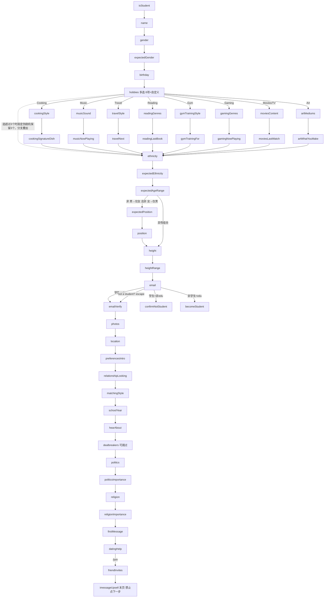

# 07 Ditto 登录后全流程（受阻版）

- 采集日期：2026-11-12
- 题库结构化文件：`assets/ditto-app/questionnaire.json`（54 条：53 道题 + 1 个过渡页；其中 18 条是条件触发页）
- 截图：`assets/ditto-app/01~05-*.png`

## 0. 结论

用户的 Gmail 登录被 Ditto 拒绝，没有创建账号，全程未点击任何提交类按钮。注册与登录只认学校邮箱，前端校验正则是 `/(\.edu|\.ca|(^|\.)ditt\.ai|(^|\.)ditto\.ai)$/`。【已证实】错误 toast 原文：「Not School email. / Please continue with your School email address.」，跳转到 `/login?error=invalid_email`。

第 3 节起的问卷来自公开前端代码 `app.tryditto.com/assets/index-B-sWZElF.js` 的只读下载，没有在真实页面上逐题看到。【已证实：代码】【未证实：界面】按钮文案、校验提示、加载态和动效都还没确认。

一个推翻旧认知的发现：Ditto 除了 iMessage，还有一整套网页端入驻问卷 `app.tryditto.com/onboarding`。

## 1. 路径与截图

| # | URL | 入口 | 截图 |
|---|---|---|---|
| 1 | `https://tryditto.com/` | — | 01-home-mobile.png |
| 2 | `https://app.tryditto.com/login` | 首页右上角 "Log In" | 02-login.png |
| 3 | `accounts.google.com/...`，回调 `https://api.ditt.ai/auth/google/cb` | "Continue with Google" | 03-google-consent.png |
| 4 | `app.tryditto.com/login?error=invalid_email` | Google「允许」之后 | 04（拍到时 toast 已消失，画面同 02） |
| 5 | `app.tryditto.com/signup` | "Sign up" 或首页 "Join Now" | 05（截到的是加载中的首页，作废） |
| — | `/join`，未登录跳 `/login?redirect=%2Fjoin` | 直接访问 | — |

- **首页。** 主标题 "get a date next wednesday"。顶部条 "Ditto ghosting? Fix it"（桌面端 "Ditto not replying? Get a new number"）。按钮 Log In / Join Now。"How it works" 四步与 9 条 FAQ 手风琴。
- **登录页。** placeholder "email or phone number"；[Continue]、"or"、[Continue with Google]、[Continue with Microsoft]；底部 "Don't have an account? Sign up"；左上返回。蓝色渐变底 + 毛玻璃卡片。
- **注册页。** placeholder "school email"，按钮同登录页，底部 "Already have an account? Log in"。

## 2. 应用路由与接口（来自代码）

路由：`/onboarding` `/onboarding/edit/:field` `/join` `/complete-profile` `/verify-number` `/application` `/phone/photo|dating-profile|done` `/schedule` `/schedule/:id` `/schedule/confirmation` `/reveal/:matchId` `/reveal-v2/:pendingMatchId` `/match/:id/accept|refuse|feedback` `/match/:id/pause-match-*` `/match/expire` `/edit-profile(/deep|verify-email|success)` `/account(/deactivate|/delete)` `/change-email` `/change-phone` `/blocklist` `/refer` `/doubles` `/double-intro` `/sidequests(/:activityId)` `/missed(/:sourceMatchId)` `/campus-type` `/pause` `/unsubscribe` `/ideal-look` `/deep-info` `/where` `/you` `/personal`

接口（域名 `api.ditt.ai`，方法与返回字段未抓到）：

- 用户与认证：`/user/me` `/user/status` `/user/profile` `/user/profile/basic-info` `/user/signup` `/user/email-first-signup` `/user/email/oauth-link` `/user/email/oauth-link/accept-not-student` `/user/email-verification` `/user/sms-verification`
- 问卷报名：`/user/onboarding/enrollment-context` `/user/onboarding/enroll`
- 照片：`/user/profile/photo/(mint-upload-url|finalize|order|ideal-date|slice/*|urls)`
- 手机号：`/user/phone-number` `/user/phone-change(/status|/choose)`
- 邮箱登录：`/auth/email/(provider|link|code|link/consume)` `/auth/link/exchange` `/auth/apple`
- 其他：`/user/deactivate` `/user/engagement/me`

## 3. 问卷顺序（默认学生流程）

进度条 3 段：yourType、aboutYou、continue。【推断：代码】

1. yourType：isStudent → name（开场 "Hi, I'm Ditto"，鸽子挥手图）→ gender → expectedGender → birthday
2. aboutYou：hobbies → 兴趣分支页（最多 3 组 × 2 页）→ ethnicity → expectedEthnicity → expectedAgeRange → expectedPosition / position（有条件）→ height → heightRange → email（含 "not a student? continue without a school email" 出口）→ emailVerify → photos → location
3. continue：preferencesIntro（过渡页）→ relationshipLooking → matchingStyle → schoolYear → hearAbout → dealbreakers（可跳过）→ politics → politicsImportance → religion → religionImportance → firstMessage → datingHelp
4. 仅 `/join` 流程：friendInvites → imessageUpsell（大概率末页，禁止点下一步）

`/join` 流程开头把 name、gender、expectedGender、birthday 合并为一个复合页，并加 phone、phoneVerification。职场流程另加 occupation、firstDateBudget、educationLevel、educationImportance、faceVerify（视频自拍），年龄范围 18–50，默认用户年龄 ±4，邮箱不限域名。

## 4. 分支树

其他分支规则：

- datingHelp 第一个选项随 expectedGender 变为 approaching guys / girls / people。
- "Everyone" 与 "No Preference" 互斥，不能和其他选项同选。
- 多选题的选择上限代码里没找到，只确认 hobbies 最多展开 3 组分支。

## 5. 未覆盖与未继续的按钮

真实页面一条路径都没走。要走真实界面，需要 `.edu` / `.ca` 学校邮箱，或 Ditto 发的测试账号。

未继续的按钮：

- 登录/注册页输入邮箱后的 "Continue"：会提交到服务端。
- "Continue with Microsoft"：同样会被学校邮箱校验拦下。
- "Get a new number" / "Fix it"：可能触发手机号或短信流程。
- 问卷各页的 Next：未能进入应用。
