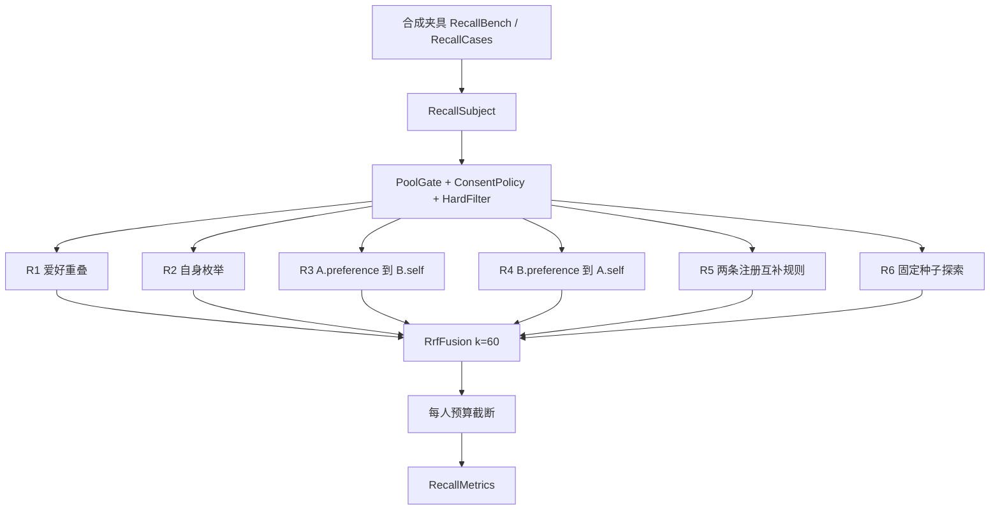

# V4-M01 设计

V4 召回是离线实验。输入是带 `synthetic-fixture` 来源的标准画像，不读生产用户，不连接 `match_user_v1`，不进入 `WeekRunner`。

B0 不走这些路线。它把已经通过资格的人按固定种子打乱，再截到同一预算。这对应今天生产侧「合法池里没有每人语义排序」这件事。无预算的合法全集只用来报覆盖上限，不拿去和 Top-K 比 Precision。

## 冻结规则

这些数在第一次消融运行之前写进 `RecallAblation`：

- RRF k = 60。权重 R1 1.0、R2 0.8、R3 1.0、R4 1.0、R5 0.7、R6 0.3。
- 每路 Top-K = 50，探索路 Top-K = 10，比较用的列表长度 = 50。
- 后一阶段只有在开发集 Recall@20 严格更高时才替换前一阶段。
- R6 的提升小于 0.02 就去掉。
- 保留集门槛：Recall@20 至少 0.60，硬约束违规、过期画像召回、撤回画像召回都是 0。
- 理由：召回先看合法正例有没有进预算；0.60 低于「把标注关系找齐」，又高于 B0 在约 90 人合法池里随机取 20 人的覆盖。安全计数必须是 0，因为召回不能制造新的硬约束例外。

路线选择用开发集。保留集只跑一次被选中的路线集合。

## 不在本轮

不改最终匹配目标函数，不做 M02 双向打分，不把模型未验证特征和反馈先验送进召回，不把哈希向量说成语义向量。
