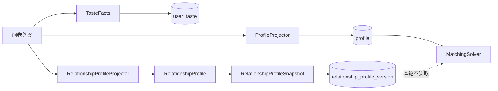

# V4-P01 设计

分支 `master_agent_v4`。本轮只建立可计算、可追溯、可版本化的关系画像。不调用真实 LLM，不改匹配评分，不把新画像送进生产匹配。算法质量仍是 NO-GO。

## 现有数据流

问卷答案进 `onboarding_answer`。两条旧链路都保留：

1. `ProfileProjector` 把答案投影成匹配用的 `profile` 行。年龄缺失时它仍会填默认 18–24。本轮不改这个行为。
2. `TasteFacts` 按白名单抽出可发给模型的事实，`TasteExtractor` / `TasteWriter` 写入 `user_taste`。`TasteWeights` 仍是 V3 对照基线：同一组 0 到 1 的权重既被当成自身特质，又被当成对伴侣的偏好，冷启动的 0.5 也不表示「不知道」。`rankAgainst` 没有改。

新链路与它们并行，没有接到入驻、召回或求解器：

`HardFilter` 继续执行年龄、身高、学历「非常看重」和性别这些既有硬条件。新画像里的 `DOCUMENTED_EXISTING_RULE` 只是指向这些已有规则，不新造否决条件。模型推断不能使用这个约束类型。

## 四类语义

| 语义 | 落点 | 本轮怎么来 |
| --- | --- | --- |
| 用户自身特征 | `SelfProfile` | 问卷里能直接读到的选项，或用户明确自述 |
| 对伴侣的偏好 | `PreferenceProfile` | 问卷里已经分开问的年龄、身高、学历看重程度、性别期望 |
| 自述行为 | `BehaviorProfile`，种类 `SELF_REPORTED` | 开场白只留 `onboarding_answer.first_message` 这个受控引用，不复制原文。情景回答和真实相处行为本轮没有 |
| 反馈记忆 | `MemoryProfile` | 只保留空集合。不接 `FeedbackLearningService` |

没有证据就不生成特征。未知不是 0.5，也不是中等偏好。「不限」是 `UNBOUNDED`，「不愿透露」是 `WITHHELD`。

## 本轮不做

- 不改 `MatchingSolver`、`Scorer`、`BlossomMatcher`、`AgentRerankService`、`AiJudge`、`RecallPipeline`、`FeedbackLearningService`、`HardFilter`、发布闸门。
- 不改 `ProfileProjector`、`ProfileProjection`、`TasteFacts` 白名单。
- 不删除或重命名 `profile`、`user_taste` 的已有列。
- 不把 AI 分身、语音情景或 LLM 虚构对话写成 `OBSERVED_BEHAVIOR`。
- 不使用 MBTI，不做颜值、价值或人格优劣等级。
- 不启动 V4-P02。并发提取、模型调用和完整更新机制留到下一轮。本轮把版本写入的唯一约束和过期输入拒绝做完。

## 最终验收修复

阶段性实现之后的源码审计有 5 项。修复只动画像写入边界，不改匹配算法，不接真实模型。细节、复现和测试名在 `V4-P01-final-audit.md`。

- 内容快照和已处理的最高源版本分开。相同内容只保留一行快照，并推进水位。更早的源版本即使迟到也不能覆盖。
- `profile.version` 必须与调用方声明的源版本一致。同一源版本的确定性投影冲突，和未来的模型修订，是两种决定。服务拒绝模型修订。
- 画像处理授权、匹配同意、发给外部模型的授权是三件事。撤回处理授权会作废当前代次。旧任务不能因为当前行被清掉就重新插入。
- 证据必须由服务端从已存储的来源解析。模型提交的 `evidenceId`、`sourceType`、`sourceVersion` 不算数。
- 普通快照不复制自由文本。职业和开场白是固定引用。正则不能证明一段自由文本已经没有私人信息。
- `aiditto.relationship-profile.processing-enabled` 默认关闭，生产配置也是 false。账户清除和授权撤回事件还没有接到这条链路。在接上之前不能开启生产画像处理。

包名是 `cn.aiditto.domain.relationship`。领域层没有 Spring、MyBatis、JDBC 或 LLM SDK。写入在 `cn.aiditto.relationship.RelationshipProfileService`，匹配代码不调用它。
