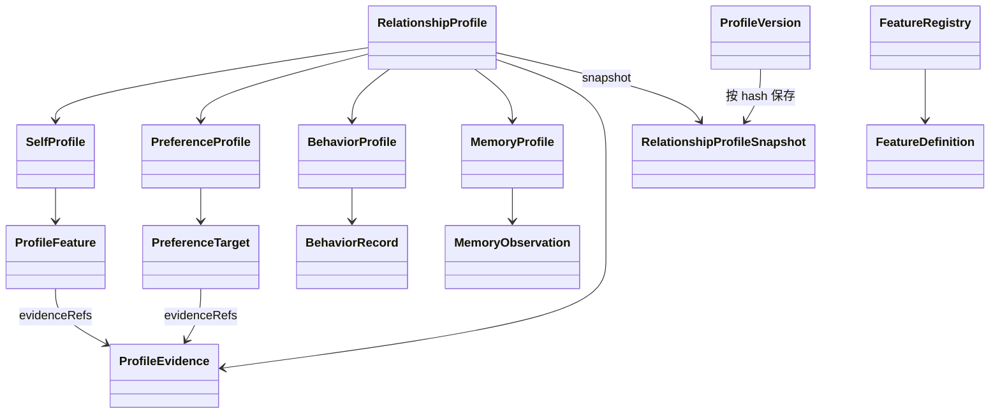

# V4-P01 领域模型

包：`cn.aiditto.domain.relationship`。对象是 Java 17 的 record 和 enum，构造后不可变。

`RelationshipProfile.of` 把证据收成当前特征。`RETRACTED` 留在证据列表里，不能支撑当前值。两条未撤回证据的结论不同时，特征是 `CONTESTED`，值为空，两条引用都保留，不覆盖。`RelationshipProfileProjector` 是另一条纯函数，不改旧的 `ProfileProjector`。

record 的公开构造器仍然存在。能进数据库的快照必须再过 `SnapshotAdmission`。它核对 schema、注册表版本、canonical、`inputHash`、四节和证据，并调用 `EvidenceTrust`。`EvidenceIds.compute` 只生成稳定 id，不证明来源存在。来源由 `EvidenceSourceDirectory` 按用户、引用和版本解析。解析结果要与证据上的类型一致，授权范围必须是 `profile-self`。`matching` 和 `model-export` 不能支撑画像。`simulated=true` 的记录不能支撑，即使用户引用没有 `persona-` 或 `llm-` 这类前缀。已撤回的来源不能支撑未撤回的证据。反馈事件和 LLM 提取本轮没有真实目录，测试用确定性替身。

普通快照的受控引用只有 `profile.expected_genders_enc`、`onboarding_answer.occupation`、`onboarding_answer.first_message`。自由文本，包括题库里没有的爱好原文，不复制进可持久化的快照。`sourceRef`、`sourceVersion` 和 `consentScope` 只能是不含长数字的短记号。`SensitiveText` 的邮箱和手机号正则只是特征注册表上的窄兜底，不能当成私人信息已经被消除。`TasteFacts` 的白名单没有放宽。

## 字段字典

### RelationshipProfileSnapshot

| 字段 | 含义 |
| --- | --- |
| userId | 画像所属用户。证据的 `subjectUserId` 必须相同 |
| schemaVersion | 本轮固定为 1 |
| featureRegistryVersion | 本轮固定为 `features-1` |
| self | 自身特征。没有证据的维度不出现 |
| preference | 伴侣偏好。目标值、重要程度、约束类型、置信度分开 |
| behavior | 自述、情景或观察。本轮投影只保留开场白的受控引用 |
| memory | 反馈观察。投影结果始终是空数组 |
| evidence | 全部证据，含已撤回。服务端计算 `evidenceId` |
| canonical | 哈希输入。键按字母序，不含生成时间和源画像版本 |
| inputHash | SHA-256(canonical)，64 位小写十六进制 |

### ProfileFeature

`featureCode`、`value`、`evidenceRefs`、`status`。`status` 为 `CONFIRMED`、`PROVISIONAL` 或 `CONTESTED`。只有矛盾时 `value` 为空。

### PreferenceTarget

| 字段 | 含义 |
| --- | --- |
| featureCode | 注册表中的偏好码 |
| operator | `EQ`、`IN`、`BETWEEN`、`AT_LEAST`、`ANY`、`CONTROLLED_REF` |
| targetValue | 希望对方满足的值。`UNBOUNDED` 表示不限 |
| importance | 用户说的重要程度：`NONE`、`KINDA`、`SUPER`。不是置信度 |
| constraintType | `SOFT` 不否决。`UNBOUNDED` 是不限。`DOCUMENTED_EXISTING_RULE` 只指向 `HardFilter` 已有规则 |
| confidence | 证据支持程度，0 到 1 的有限数。不是该特征的客观概率 |
| evidenceRefs | 服务端证据 id |
| status | 与特征相同。推断保持 `PROVISIONAL`，且约束只能是 `SOFT` |

已有硬规则只有 `partner.age`、`partner.height`、`partner.education`、`partner.gender`，并且必须来自已确认的直接答案。

### BehaviorRecord

`featureCode`、`kind`、`value`、`evidenceRefs`、`status`。`kind` 是 `SELF_REPORTED`、`SCENARIO_RESPONSE`、`OBSERVED_BEHAVIOR`。最后一种只能来自 `FEEDBACK_OBSERVATION`，并且来源引用不能以 `voice-`、`voice:`、`persona-`、`persona:`、`llm-`、`llm:`、`sim-`、`sim:` 开头。

### MemoryObservation

`observationId`、`featureCode`、`sourceEventRef`、`observationType`、`polarity`、`confidence`、`evidenceRefs`、`status`。没有反馈就是空集合。模型输出不能进入这一节。本轮不编造约会。

### ProfileEvidence

| 字段 | 含义 |
| --- | --- |
| evidenceId | SHA-256(`userId|source|sourceRef|sourceVersion|featureCode`) 的前 32 位。调用方不能指定 |
| subjectUserId | 证据所属用户 |
| featureCode / section / claim | 这条证据支持什么 |
| sourceType | `DIRECT_ANSWER`、`SELF_REPORTED`、`MODEL_INFERENCE`、`FEEDBACK_OBSERVATION` |
| sourceRef / sourceVersion | 题目 id 或案例引用，以及 `catalog-1` 这类版本 |
| confidence | 证据强度。非法值、NaN、Infinity 直接拒绝 |
| status | `CONFIRMED`、`PROVISIONAL`、`RETRACTED` |
| visibility | 本轮 `OWNER` |
| consentScope | 本轮 `profile-self` |
| operator / importance / constraintType | 只在偏好上必填 |
| behaviorKind / polarity | 分别只在行为和记忆上必填 |

### FeatureValue

`BOOLEAN`、`ENUM`、`ENUM_SET`、`NUMBER`、`RANGE`、`TEXT`，外加三种不是普通值的标记：`UNBOUNDED`（不限）、`WITHHELD`（不愿透露）、`CONTROLLED_REF`（只存指针）。敏感特征只能是受控引用或不限，不能把选项原文抄进快照。

### ProfileVersion

`userId`、`version`、`schemaVersion`、`featureRegistryVersion`、`sourceProfileVersion`、`inputHash`、`createdAt`、`current`、`retractedAt`。`createdAt` 和 `sourceProfileVersion` 不进入哈希。

## 六组虚构画像

这些用户 id 是 9101–9106。快照只存在测试和下面的文件里，不写入生产库，也不进入求解器。文件内容就是完整的 canonical JSON。哈希是这份 JSON 的 SHA-256。文件保持原样。含自由文本的案例，例如案例一里的「摄影」，仍然能在内存里构造，用来说明领域对象。`SnapshotAdmission` 拒绝把这种自由文本写入持久化层。

| 案例 | 文件 | inputHash | 要看的区分 |
| --- | --- | --- | --- |
| 互补 A | `profiles/case-1-a.json` | `8a03c84c1cb3f9653bdd3b6a59d6a5d011d7551202ab20ff5494bdd01c89dffa` | 自述主动性低、兴趣含阅读；「摄影」只作为自述原文，因为题库没有这个选项。希望对方主动性高，重要程度 `KINDA`，置信度 0.9，约束 `SOFT`。没有把愿望写成 A 自己的性格，也没有 MBTI |
| 互补 B | `profiles/case-1-b.json` | `e901afe76e2494b58d6b82d3291b1ed8a668125a1c51f5d0d7bd7d65c44b5515` | 自述旅行、音乐、主动性高。希望对方主动性低，用来承接「稳定、有耐心」这句明确自述。没有把这句话写成 B 已经具备的事实 |
| 偏好相似、自身不同 | `profiles/case-2-similar-pref-reading.json`、`profiles/case-2-similar-pref-gym.json` | `20bbe2435bbd35b3a42858a4910078ef43bff97756467059fe5684e421c42d09`、`14a08f45e0e7297dec76242f7ead68f0b97ac8c3f98e12b867cb257e43399a90` | 两边都希望对方主动性高。一边兴趣是阅读，一边是健身 |
| 单向偏好 | `profiles/case-3-one-way-a.json`、`profiles/case-3-one-way-b.json` | `711a40ed2fda01e0fe2d8419dce607f784c568d9dedce1ea3097703cbb5af37e`、`b6a29571588faf1eb992b8b06e0e23bfab15ed811ef666ffa45dcd581bb35309` | A 希望对方节奏快。B 只有自述节奏慢，没有对应偏好。快照里没有分数 |
| 冷启动 | `profiles/case-4-cold-start.json` | `731778ed46e4ebb9600b4cfe439dff262517ddb7b34b357b98eda7cfcb9c68ce` | 只有关系目标 `serious`。其余维度不出现，记忆为空，没有 0.5 |
| 偏好变化 | `profiles/case-5-before.json`、`profiles/case-5-after.json` | `40b0b8002851cc692e5eb9cba40b37222d24f13e8c0fee25469cca6092539020`、`f99e308d1a407c6529f4bfcf74dc34ca3d7de534f015a73f39f97dd1fbeb1a97` | 年龄段和学历看重程度变了，哈希就变。`kinda` 是软偏好，`super` 才指向既有学历硬规则 |
| 矛盾与撤回 | `profiles/case-6-contested.json` | `b4807cddd686445b1e324130664e9385b2e2f67baffe3f7137d0063a25b347d9` | 低和高同时有效，当前特征是 `CONTESTED` 且没有值。已撤回的 `steady` 仍在证据里，不在当前引用里 |

案例一到案例三、案例六里的主动性、节奏和「摄影」是虚构自述，来源类型是 `SELF_REPORTED`，来源引用以 `case-` 开头。它们不是 `questions.json` 里的答案。问卷投影器不会生成这些字段。
