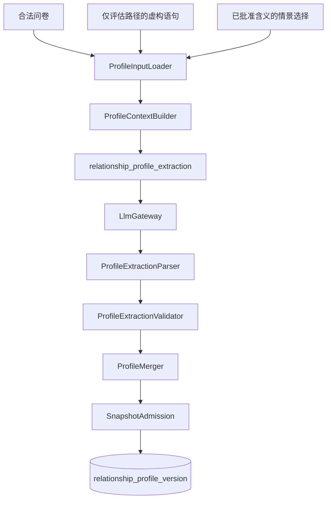

# V4-P02 设计

分支 `master_agent_v4`。本轮在 P01 的画像模型上增加模型无关的提取。生产画像处理保持关闭。匹配算法不改。真实约会反馈不接入。

P01 的验收基线是 `ff4cf2169f5aff3839abfacc28e2e7bac3cdc998`。`RelationshipProfile`、`FeatureRegistry`、`ProfileEvidence`、`SnapshotAdmission`、`ProfileVersionPolicy` 和 `RelationshipProfileService` 继续是唯一的画像写入路径。

## 架构

调用顺序：

1. 短事务读取账户、`profile.version`、处理代次、处理授权、模型外发授权和 `model_export_epoch`。这一步不加用户行锁。
2. 构建生产上下文。调用方带来的语句被忽略。没有处理授权时直接拒绝。没有模型外发授权时不调用模型。
3. 按用户、输入哈希、Prompt 版本和处理代次领取任务。新任务写入 `attempt_id`、`fence`、约 30 秒的 `lease_until` 和当时的外发代次。活租约返回 busy。过期租约在次数小于 3 时换新的 fence 再执行。次数用尽则标成 discarded。
4. 调用模型之前再读一次当前授权、账户、源版本、处理代次和外发代次。这一读是发送判定。读完到字节离开本进程之间仍有竞态。已经交给外部服务的数据不能说成被本地撤回。
5. 在事务外调用 `LlmGateway`。整个调用期间不持有用户行锁。
6. 解析严格 JSON。非法 JSON 或模型异常把这一 fence 标成 degraded，不让任务停在 running。
7. 短事务重新核对处理代次、外发代次和输入哈希，校验候选，合并，写入，并用同一事务把该 fence 标成 completed。完成更新不是恰好一行时，画像写入一起回滚。

`saveModelRevision` 仍立即拒绝调用方提交的快照。服务端合并只走 `commitProvisional`。模型修订在当前源版本已经有确定性快照时追加一行，水位停在该源版本。源版本还没有确定性快照时，模型修订不插入、也不推进水位。

模型调用期间不持有 `SELECT id FROM "user" WHERE id=? FOR UPDATE`。

## 三类信息

| 范围 | 内容 |
| --- | --- |
| 服务端内部 | userId、答案映射、语句、情景键、授权和代次 |
| 普通快照 | 注册表允许的特征值、受控引用、证据元数据 |
| 模型外发 | `exportCanonical`：本次证据引用、特征码和通过 `FreeTextPolicy` 的短文本 |

外发 JSON 不包含 userId。输入哈希覆盖外发正文、源版本、处理代次、模型外发代次、Prompt 版本和注册表版本，不覆盖 userId。

生产路径不外发自由文本。`FreeTextPolicy.productionExportsFreeText()` 返回 false。字母类别、长度和正则不能证明一段文字没有私人信息。评估路径可以暴露已经写在夹具里的虚构句子，那个检查不是匿名化。职业、开场白、期望性别、情景题面、加密自定义回答和另一位用户的行都不外发。

情景行只有在所选选项的 `text` 正好是 `low`、`steady` 或 `high` 时才进入上下文。选项字母本身不是含义。题面、`trait`、`trait_signal` 和 `custom_text_enc` 不外发。无法还原批准含义的题不参与提取。

证据引用由服务端签发，形如 `ev-1`。指纹形如 `f` 加 16 个 `a`–`p`。`IssuedEvidenceDirectory` 只解析本次用户、本次引用和本次指纹。另一位用户或另一个指纹解析不到。

## 模型边界

领域层依赖 `LlmGateway` 和 `LlmRequest`。它不依赖 OpenAI SDK 或 LangChain4j。CI 的 `aiditto.llm.mode` 默认是 mock。`MockLlmModel` 可以返回合法 JSON，也可以注入非法 JSON、超时、限流和服务异常。

模型输出是候选特征。服务端决定 `evidenceId`、用户、来源类型、来源版本、授权范围、状态、可见性和约束类型。模型证据的来源是 `MODEL_INFERENCE`，状态是 `PROVISIONAL`。偏好约束只能是 `SOFT`。

## 合并

同一分节、同一特征码上，只要已经有确定性证据，模型候选就留在外面。撤回的确定性证据同样挡住候选。置信度数值不覆盖用户事实。`MemoryProfile` 保持空数组，本轮不写反馈观察。

## 任务

`V16__relationship_profile_extraction.sql` 保持原样。`V17__extraction_lease_and_export_epoch.sql` 增加任务的 `attempt_id`、`fence`、`lease_until`、`model_export_epoch`，以及生命周期表的 `model_export_epoch`。主键仍是用户、输入哈希、Prompt 版本和处理代次。状态仍是 `running`、`completed`、`discarded`、`degraded`。尝试次数仍是 1 到 3。行里没有 Prompt 正文、用户原文或模型上下文。

从 revoked 重新授予外部模型授权，以及从 granted 撤回，都会把 `model_export_epoch` 加一。重复的相同操作不加。旧代次的任务即使后来又授予，也不能写入。匹配同意、画像处理授权和外部模型授权仍然分开。

`llm_call_log` 继续只记调用点、模型、token 数、耗时和状态。日志不写用户原文。

`llm_call_log` 继续只记调用点、模型、token 数、耗时和状态。
