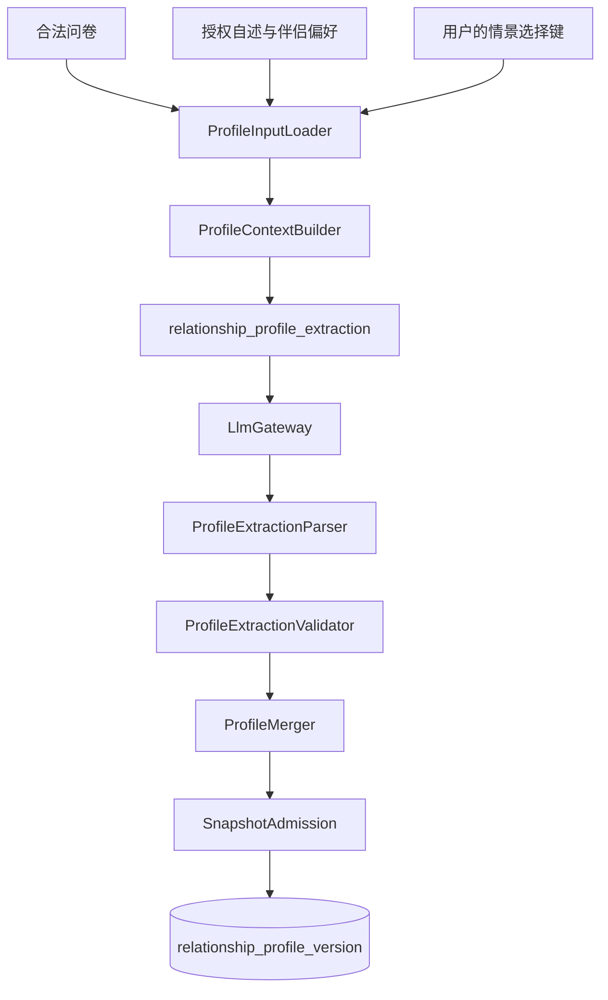

# V4-P02 设计

分支 `master_agent_v4`。本轮在 P01 的画像模型上增加模型无关的提取。生产画像处理保持关闭。匹配算法不改。真实约会反馈不接入。

P01 的验收基线是 `ff4cf2169f5aff3839abfacc28e2e7bac3cdc998`。`RelationshipProfile`、`FeatureRegistry`、`ProfileEvidence`、`SnapshotAdmission`、`ProfileVersionPolicy` 和 `RelationshipProfileService` 继续是唯一的画像写入路径。

## 架构

调用顺序：

1. 短事务读取账户、`profile.version`、代次、处理授权和模型外发授权。这一步不加用户行锁。
2. 构建上下文。没有处理授权时直接拒绝。没有模型外发授权时不调用模型。
3. 按用户、输入哈希、Prompt 版本和代次插入去重行。冲突时不再调用模型。
4. 在事务外调用 `LlmGateway`。
5. 解析严格 JSON。非法 JSON 标记为 degraded，不写模型特征。
6. 短事务重新读取账户、源版本、代次和两项授权，重建上下文并核对输入哈希。
7. 校验候选，与确定性投影合并，经 `SnapshotAdmission` 后按 `WriteMode.MODEL_REVISION` 写入。

`saveModelRevision` 仍立即拒绝调用方提交的快照。服务端合并只走 `commitProvisional`。模型修订在当前源版本已经有确定性快照时追加一行，水位停在该源版本。源版本还没有确定性快照时，模型修订不插入、也不推进水位。

模型调用期间不持有 `SELECT id FROM "user" WHERE id=? FOR UPDATE`。

## 三类信息

| 范围 | 内容 |
| --- | --- |
| 服务端内部 | userId、答案映射、语句、情景键、授权和代次 |
| 普通快照 | 注册表允许的特征值、受控引用、证据元数据 |
| 模型外发 | `exportCanonical`：本次证据引用、特征码和通过 `FreeTextPolicy` 的短文本 |

外发 JSON 不包含 userId。输入哈希覆盖外发正文、源版本、代次、Prompt 版本和注册表版本，不覆盖 userId。

`FreeTextPolicy` 只放行 2 到 40 个字母，外加空格、`，` 和 `。`。拒绝是省略。省略不表示剩余文本已经匿名。正则不能单独作为脱敏证明。职业、开场白、期望性别、情景题面和加密的自定义回答都不外发。情景行只贡献 `chosen_key` 为 A–D 的选择。

证据引用由服务端签发，形如 `ev-1`。指纹形如 `f` 加 16 个 `a`–`p`。`IssuedEvidenceDirectory` 只解析本次用户、本次引用和本次指纹。另一位用户或另一个指纹解析不到。

## 模型边界

领域层依赖 `LlmGateway` 和 `LlmRequest`。它不依赖 OpenAI SDK 或 LangChain4j。CI 的 `aiditto.llm.mode` 默认是 mock。`MockLlmModel` 可以返回合法 JSON，也可以注入非法 JSON、超时、限流和服务异常。

模型输出是候选特征。服务端决定 `evidenceId`、用户、来源类型、来源版本、授权范围、状态、可见性和约束类型。模型证据的来源是 `MODEL_INFERENCE`，状态是 `PROVISIONAL`。偏好约束只能是 `SOFT`。

## 合并

同一分节、同一特征码上，只要已经有确定性证据，模型候选就留在外面。撤回的确定性证据同样挡住候选。置信度数值不覆盖用户事实。`MemoryProfile` 保持空数组，本轮不写反馈观察。

## 任务

`V16__relationship_profile_extraction.sql` 的主键是用户、输入哈希、Prompt 版本和代次。状态是 `running`、`completed`、`discarded`、`degraded`。尝试次数是 1 到 3。行里没有 Prompt 正文、用户原文或模型上下文。

相同输入在 `completed` 之后不再调用模型。`degraded` 和 `discarded` 在次数小于 3 时可以再试。`running` 表示另一个调用正在进行，后来的调用不再打模型。网关失败或非法 JSON 保持已有确定性快照。源版本、代次、账户或模型外发授权变化后，已经返回的结果丢弃。

`llm_call_log` 继续只记调用点、模型、token 数、耗时和状态。
