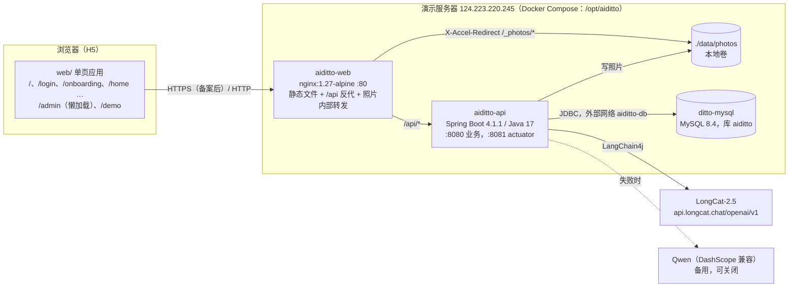
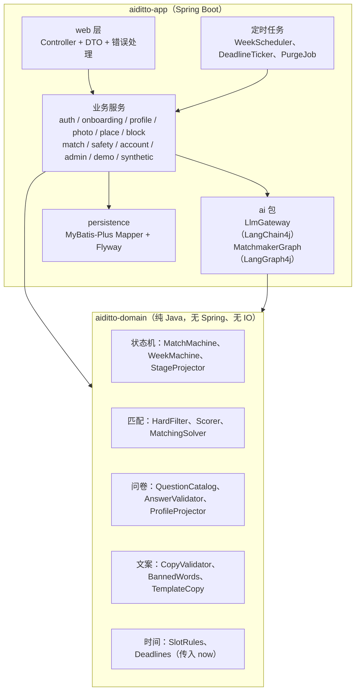
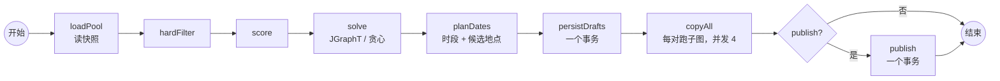
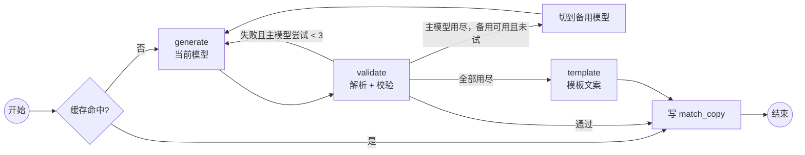

# 技术方案：见一面（TryDitto 中国版高保真复刻）

- 状态：v2，待评审。评审通过前不写后端代码。
- 日期：2026-11-13
- 取代：`docs/archive/技术方案-v1-nextjs.md`（下文称 v1）。v1 的数据模型思路、状态机写法、周批次幂等、大模型调用点与程序校验、测试分层、成本算法在本版保留，技术栈换掉。
- 引用写法：「13 §2.2」指 `docs/research/13-ditto-资料编辑与深度信息实录.md` 第 2.2 节；「PRD §4.7」指 `docs/PRD.md`；「前端契约」指 `web/src/api/index.ts` 和 `web/src/api/types.ts` 里的 TODO 注释与类型。
- 证据标签沿用调研：【已证实】【推断】【未验证】。没有标签的句子是本方案的设计决定。【未验证】专指「版本或接口行为写在这里，但沙箱不能联网，开工第一天要用真实依赖跑一次冒烟测试」。

---

## 1. 范围与改动

### 1.1 这一版要交付什么

一套能在演示服务器上跑通的完整闭环：

```
登录（手机号 + 固定演示码）→ 入驻问卷 → 每周匹配（也可由后台「立即匹配」）
→ 约会方案卡片（AI 写的理由、开场白、地点）→ 双方勾选时段 → 系统定时间
→ 见面当天（到达）→ 反馈 → 双方都想再见才显示微信号
```

配套：约 200 名合成用户、几个固定演示账号、`/demo` 演示面板、`/admin` 后台（立即匹配、看批次、看大模型调用日志、处理举报、一键重置）。

不做：真实短信和邮件（验证码一律是环境变量 `DEMO_LOGIN_CODE`）、内容审核接入、对象存储云服务、多实例部署、收费。ICP 备案下来之前只跑 HTTP 和 IP 访问。

### 1.2 相对 v1 的改动

| v1 | 本版 | 理由 |
|---|---|---|
| Next.js 全栈 + Python 匹配器 | Java 17 + Spring Boot 4.1.1 后端，前端 `web/`（Vite + React）独立构建 | 固定决定。匹配器也改成纯 Java，一个进程、一种语言，写库的只有一个进程这条原则不变 |
| PostgreSQL | MySQL 8.4 + Flyway + MyBatis-Plus | 演示服务器上已经有 `ditto-mysql`。v1 依赖的 `timestamptz`、数组列、advisory lock 都要换写法（见第 4 节、第 5.4 节） |
| OR-Tools CP-SAT | JGraphT 一般图最大权匹配，贪心兜底 | Java 里没有和 Python 版同样顺手的 CP-SAT 用法。200 到 2000 人的规模，最大权匹配加硬过滤已经够用；「每人至多一条边、低分宁缺」两条约束都能表达（第 7 节） |
| 大模型直连 DeepSeek / 百炼 | LangChain4j（OpenAI 兼容）调 LongCat-2.5，Qwen DashScope 兼容接口做备用；LangGraph4j 编排红娘流水线 | 固定决定。第 8 节写清每个调用点的模式和兜底 |
| 校园单校、edu.cn 必填、PRD 的四段问卷 | 照搬前端已经做好的 Ditto 问卷（`web/src/onboarding/questions.ts`），学生和职场两条路径 | 前端已经按 Ditto 实录做完，后端以前端题库为准。题目 id 见第 6.4 节 |
| 双方确认时间要再点一次「确认」 | 选时段就是确认：后一方提交时段时系统直接求交集定时间 | 前端的流程是 `revealed → awaitingPartner → confirmed`，没有单独的确认页（`index.ts` 的 `confirmSlots` 和 `demo.partnerConfirms`） |
| 照片走阿里云审核 | 演示阶段不审核，只做格式、大小、去 EXIF；保留 `moderation` 字段 | 演示环境没有审核账号。上线前必须接（第 9 节） |

v1 里继续有效、本版沿用的原则：

1. **每一方只写自己那一行。** 双方的回应、时段、反馈各写各的 `match_side` / `feedback`，匹配级状态只由一个函数在事务里推进。
2. **不可变快照。** 每次批次锁定时记下每个参与者用的是哪个 `profile.version`，求解输入存成 JSON 并算哈希。
3. **状态机写成迁移表。** 所有状态推进都经过同一张表，不在各处写 `if`。
4. **大模型不决定谁和谁配对，不选地点以外的东西，不看照片。** 地点只能从程序给的候选里挑。
5. **模型输出先过程序校验，再落库。** 校验不过就重试、换备用模型，最后用模板句。

### 1.3 前端契约：照抄的部分和刻意改动

API 路径、方法、请求体都按 `web/src/api/index.ts` 和 `web/src/landing/auth.ts` 的 TODO 照抄（完整清单见第 6 节）。下面这些是刻意改动，前端接后端时要一起改：

| # | 前端现状 | 改成 | 理由 |
|---|---|---|---|
| F1 | `getMe()`、`getCurrentMatch()` 是同步函数 | 改成 `async`，页面用 hook 包一层 | 要走网络 |
| F2 | `index.ts` 的 `AUTH_STORAGE_KEY = 'jym-auth'`，而 `auth.ts` 实际持久化在 `jym-auth-v1` | 统一用 `useAuth.getState().logout()`，删掉这个常量 | 现在 `logout()` 删错了 key，是个现成 bug |
| F3 | 照片是 `string[]`（data URL） | 照片是 `{ id, url }[]`；`setPhotos` 发 `ids` | 排序和删除要靠 id，TODO 里写的也是 `PUT /api/photos/order { ids }` |
| F4 | 服务端生成的文案字段是 `T`（`{ en, zh }`） | 匹配卡片、理由、开场白、地点等由服务端生成的文字是单语字符串，按请求头 `Accept-Language` 返回中文或英文；前端适配层包成 `t(s, s)` | 大模型只写一种语言，成本减半。地点库（places）是静态数据，仍返回 `T` |
| F5 | `flagReason` 本地翻转 | 请求体带目标状态 `{ flagged: true/false }` | 翻转语义在网络重试时不幂等 |
| F6 | `acceptMatch` 是空函数 | 保留接口，只记录「点了去」的时间用于漏斗统计，不改状态。真正的「去 + 时段」是 `slots/confirm` | 和前端现有行为一致 |
| F7 | `MatchStage` 没有「时段无交集」 | 新增 `noOverlap` 阶段：双方各有一次重选机会。前端没加之前，后端把它投影成 `closed` | 服务端需要这个状态，前端少一个页面 |
| F8 | `emailVerify` 的 6 位码作为问卷答案存进 `answers` | 服务端不存验证码。`PUT /api/onboarding/answers/emailVerify` 只检查该邮箱是否已验证，已验证返回 204，否则 409 | 验证码不应进入答案表 |
| F9 | `saveAnswer` 不带进度 | 请求体可选带 `furthestStepId` | `getProgress()` 要返回它，服务端得有地方收 |
| F10 | `Partner.avatar` 是生成头像规格 | 真实用户返回 `photos: string[]`；合成用户返回 `avatar` + `scenes`，`photos` 为空 | 合成用户没有真人照片，继续用前端的 SVG 头像 |
| F11 | `Partner.wechat` 总是有值 | 只在 `mutual` 阶段返回，其余阶段为 `null` | 联系方式是闸门（PRD §4.7） |
| F12 | `Me.phone` 明文 | 返回掩码 `138****1234`；新增 `status`、`photoIssue`、`isAdmin`、`demoMode` 字段（可选，向后兼容） | 13 §0：照片不合格要能把人拦回照片步 |
| F13 | 演示面板直接改本地库 | 改成调 `/api/demo/*`（第 6.10 节），只在 `DEMO_MODE=true` 时挂载 | 演示动作也走同一台状态机，避免造出非法状态 |

---

## 2. 架构与模块边界

### 2.1 架构图



### 2.2 进程内的模块



| 模块 | 职责 | 边界规则 |
|---|---|---|
| `aiditto-domain` | 状态迁移表、阶段投影、时段与截止时间、硬过滤、打分、求解、问卷校验、答案到画像的投影、模型输出校验、模板文案 | Maven 模块里不引 Spring、MyBatis、LangChain4j。时间一律由参数 `now` 传入。所有「业务规则」的测试都在这里 |
| `web` | 解析请求、鉴权、把领域错误映射成错误码 | Controller 不写业务判断，只调服务 |
| 业务服务 | 事务边界、读写库、调用领域函数 | 匹配级状态只由 `MatchService.apply(event)` 推进，它在事务里 `SELECT … FOR UPDATE` 锁住 `match` 行 |
| `ai` | 大模型网关（重试、超时、换模型、日志）、提示词版本、红娘流水线 | 只有这里 import LangChain4j / LangGraph4j。业务服务通过接口 `MatchCopyWriter`、`ProfileExtractor` 使用它 |
| 定时任务 | 周批次各步骤、每分钟推进截止事件、注销清理 | 只调服务，不直接写状态 |
| `admin` / `demo` | 后台和演示接口 | 只能通过服务和状态机改数据；`demo` 包在 `DEMO_MODE=false` 时不注册任何 Bean |

用一个 ArchUnit 测试锁住这些依赖方向（第 11 节）。

### 2.3 后台放在哪

`/admin` 放在同一个前端应用里，用 `React.lazy` 拆成单独的代码块，普通用户不会下载。前端只根据 `me.isAdmin` 显示入口，真正的权限在服务端：`/api/admin/**` 要求 `ADMIN` 角色。

理由：一次构建、一次部署，共用组件和 API 客户端。代价是后台的界面代码会公开，但里面没有密钥，可以接受。

管理员账号：手机号写在环境变量 `ADMIN_PHONES`（逗号分隔），用这些手机号登录即获得 `ADMIN` 角色。

---

## 3. 工程结构

### 3.1 目录

```
tryditto-cn/
├── web/                         # 已有前端
│   └── scripts/export-questions.mjs   # 新增：导出题库 JSON 给后端
├── api/                         # 新增：Maven 多模块
│   ├── pom.xml                  # cn.aiditto:aiditto-parent，统一版本（BOM）
│   ├── mvnw, .mvn/
│   ├── aiditto-domain/
│   │   └── src/main/java/cn/aiditto/domain/
│   │       ├── match/      MatchState, MatchEvent, MatchMachine, StageProjector, Outcome
│   │       ├── week/       WeekState, WeekMachine, WeekCalendar
│   │       ├── slot/       SlotRules, Deadlines
│   │       ├── matching/   Candidate, HardFilter, Scorer, Weights, MatchingSolver, GreedySolver
│   │       ├── questionnaire/ QuestionCatalog, AnswerValidator, ProfileProjector, FieldAliases
│   │       ├── copy/       MatchCopy, CopyValidator, BannedWords, TemplateCopy
│   │       └── common/     Ids, DomainException, ErrorCode
│   ├── aiditto-app/
│   │   └── src/main/java/cn/aiditto/
│   │       ├── AidittoApplication.java
│   │       ├── auth/  onboarding/  profile/  photo/  place/  block/
│   │       ├── match/  week/  safety/  account/  referral/
│   │       ├── ai/     LlmGateway, LlmProfile, PromptRegistry, MatchmakerGraph, nodes/
│   │       ├── admin/  demo/  synthetic/
│   │       └── infra/  crypto/, web/, persistence/, clock/, config/
│   │   └── src/main/resources/
│   │       ├── application.yml, application-prod.yml, application-test.yml
│   │       ├── db/migration/   V1__…sql …、R__seed_places.sql
│   │       ├── questions.json            # 由 web/scripts/export-questions.mjs 生成
│   │       ├── prompts/match_copy.v1.md, profile_extract.v1.md
│   │       └── synthetic/users-v1.json   # 200 名合成用户夹具
│   └── aiditto-eval/            # 可选：大模型评测与合成人群报告，不进生产 jar
├── contracts/fixtures/          # 新增：前后端共用的 JSON 样例（契约测试）
├── deploy/
│   ├── docker-compose.yml  nginx.conf  deploy-web.sh
│   ├── deploy-api.sh            # 新增
│   └── backup.sh                # 新增
└── docs/
```

为什么是两个 Maven 模块而不是一个或更多：

- 拆出 `aiditto-domain`，让「业务规则不碰数据库和框架」由编译器保证，AI 编码代理写错依赖会直接编译失败。
- 不再继续拆（例如单独的 `ai`、`admin` 模块），因为 Maven 多模块的样板对代理不友好，跨模块改契约也容易漏。`aiditto-app` 内部按功能分包，用 ArchUnit 管依赖方向。
- `aiditto-eval` 只放评测代码，可以先不建。

### 3.2 题库单一来源

题库只有一份：`web/src/onboarding/questions.ts`。构建时由 `web/scripts/export-questions.mjs` 导出 `questions.json`，内容是每题的 `id`、`type`、选项 id 列表（`optionsFor` 按所有分支展开成并集）、`maxSelect`、`maxLength`、`exclusive`、`optional`、`emailKind`、`allowCustom`、`private`、`hobby`、`drop`。后端 `QuestionCatalog` 只读这个文件。契约测试在两边各跑一次，任一边改了题而没重新导出，测试失败。

### 3.3 版本兼容假设与退路

2026-11-13 已在 Maven Central 核对坐标和最新版本【已证实】：

| 坐标 | 版本 |
|---|---|
| `org.springframework.boot:spring-boot` | 4.1.0、4.1.1、4.1.2 均已发布；4.2.0 还在 RC。用 4.1.1（可升 4.1.2 补丁） |
| `org.springframework.boot:spring-boot-starter-flyway` | 存在（Boot 4 起 Flyway 要显式引这个 starter） |
| `com.baomidou:mybatis-plus-spring-boot4-starter` | 3.5.18（Boot 4 专用 starter 已存在） |
| `org.flywaydb:flyway-mysql` | 13.12.2 |
| `dev.langchain4j:langchain4j-open-ai` | 1.23.0 |
| `org.bsc.langgraph4j:langgraph4j-core` | 1.9.9 |
| `org.jgrapht:jgrapht-core` | 1.5.3 |
| `net.jqwik:jqwik` | 1.10.2 |

坐标存在不等于能一起跑。下表的行为假设（Jackson 3、`customParameters`、jqwik 与 JUnit 6 等）仍标【未验证】。开工第一个任务（M1 的 U0）就是用这些版本搭一个空项目，把下表每一行跑一遍冒烟测试，结果写回本节。

| 组件 | 假设 | 风险点 | 退路 |
|---|---|---|---|
| Spring Boot 4.1.1 | 基线 Java 17，Spring Framework 7，Spring Security 7，默认 Jackson 3（包名 `tools.jackson`），自动配置拆成多个模块（Flyway 要显式引 `spring-boot-starter-flyway`）【未验证】 | 第三方 starter 还没跟上 4.x | 整体退回 Spring Boot 3.5.x。为了让退路便宜：不用 4.x 独有功能（API 版本化、声明式 HTTP 服务客户端注解等）；JSON 处理收在一个 `Json` 工具类里；Jackson 注解用 `com.fasterxml.jackson.annotation`（Jackson 3 仍沿用这个包名）【未验证】 |
| MyBatis-Plus | `mybatis-plus-spring-boot4-starter` 3.5.18 已发布【已证实】；和 Boot 4.1.1 能否一起启动【未验证】 | starter 和 Boot 4.1 不兼容 | 先试 `mybatis-spring-boot-starter` 4.x 加 `mybatis-plus-extension`，手写 `MybatisSqlSessionFactoryBean` 配置；再不行，复杂查询本来就用 Spring `JdbcClient` 写，Mapper 改成 MyBatis 原生 |
| MyBatis-Plus 的 JSON 列 | 内置 `JacksonTypeHandler` 用 Jackson 2 | 和 Boot 默认的 Jackson 3 并存 | 自己写一个基于 Jackson 3 的 `JsonTypeHandler`（约 40 行），不依赖内置的 |
| Flyway | 最新 13.x（`flyway-mysql` 13.12.2【已证实】），具体版本以 Boot 4.1.1 管理的为准；支持 MySQL 8.4【未验证】 | 老版本对 8.4 打「版本过新」警告 | 升到 Boot 管理的最新版本；仍不行就把 `spring.flyway.fail-on-missing-locations` 之类的检查保持默认，只接受警告 |
| MySQL Connector/J | 9.x，`com.mysql:mysql-connector-j` | MySQL 8.4 默认关闭 `mysql_native_password`，`caching_sha2_password` 在非 TLS 首次认证需要 RSA 公钥 | 连接串用 `sslMode=REQUIRED`（8.4 自动生成证书），不开 `allowPublicKeyRetrieval` |
| LangChain4j | 1.x 稳定版，只用 `langchain4j` + `langchain4j-open-ai` 两个库，不用它的 Spring Boot starter；`OpenAiChatRequestParameters` 支持 `customParameters(Map)` 往请求体里加任意字段【未验证】 | `customParameters` 在所选版本不存在或不往 body 里合并；LangChain4j 内部用 Jackson 2 | 自己实现 LangChain4j 的 `ChatModel` 接口：`OpenAiCompatChatModel`，用 JDK `HttpClient` 直接 POST `/chat/completions`（约 150 行）。流水线只依赖 `ChatModel` 接口，换实现不影响别处 |
| LangGraph4j | `org.bsc.langgraph4j:langgraph4j-core` 1.x，Java 17 可用，只用 `StateGraph`、`AgentState`、条件边，不用它的检查点存储和 Spring AI 集成【未验证】 | API 在小版本间改名 | 节点都写成我们自己的接口 `PipelineNode<S>`，LangGraph4j 只是一个适配层。万一用不了，换成约 80 行的自写顺序执行器，节点代码不动 |
| JGraphT | 1.5.x，用 `KolmogorovWeightedPerfectMatching`（Java 11+）【未验证】 | 浮点精度、大图性能 | 权重用整数；超时或异常时退回 `GreedySolver`（第 7.5 节） |
| JUnit / jqwik | Boot 4 可能带 JUnit Jupiter 6；jqwik 1.9.x 是否支持 JUnit Platform 6 未知【未验证】 | jqwik 引擎装不上 | 把 jqwik 测试放进单独的 surefire 执行并钉住平台版本；仍不行，用 JUnit 参数化测试加固定种子的随机生成器代替，测的性质不变 |
| Testcontainers | 2.x，模块名可能改为 `testcontainers-mysql`；Boot 的 `@ServiceConnection` 可用【未验证】 | 坐标变化 | 按实际坐标改 pom，用法不变 |

Java 17 没有虚拟线程。大模型并发用固定大小的线程池（第 8.4 节）。

---

## 4. MySQL 表设计

### 4.1 通用约定

- 引擎 InnoDB，字符集 `utf8mb4`，排序规则 `utf8mb4_0900_ai_ci`。
- 主键 `BIGINT`，由 MyBatis-Plus `ASSIGN_ID`（雪花算法）生成。对外 JSON 一律序列化成字符串，避免 JavaScript 精度问题，也不暴露自增序号。地点表例外，主键是可读字符串（`pku`）。
- 时间列 `DATETIME(3)`，存 UTC。JDBC 连接串加 `connectionTimeZone=UTC&forceConnectionTimeZoneToSession=true`。业务时间（周三 19:00、截止时间）在领域层按 `Asia/Shanghai` 计算后再转 UTC 存储。
- 布尔用 `TINYINT(1)`；枚举用 `VARCHAR(24)` 加 `CHECK` 约束（MySQL 8.0.16 起生效），不用 MySQL `ENUM`，改枚举时只改约束。
- JSON 用 MySQL `JSON` 列。需要索引的字段不放 JSON 里。
- 加密列 `VARBINARY`，内容是 `密钥版本(1 字节) + IV(12) + AES-256-GCM 密文`。哈希列 `BINARY(32)`，是 `HMAC-SHA256(HASH_PEPPER, 规范化值)`，用于唯一约束和屏蔽名单比对。
- 软删除只用于用户自己能恢复的东西（照片、注销冷静期）。其余不做全局软删除。
- 乐观锁：`match` 表带 `version`。

### 4.2 Flyway 命名

- 版本迁移：`V{n}__{动词}_{对象}.sql`，例如 `V1__create_user_auth.sql`。`n` 是连续整数，不用日期。
- 可重复迁移：`R__seed_places.sql`（地点库），内容变了就重跑，必须写成 `INSERT … ON DUPLICATE KEY UPDATE`。
- 已执行的版本迁移永远不改，改错了就新加一个。`spring.flyway.validate-on-migrate=true`，生产配置 `clean-disabled=true`。
- 迁移只做「先加后删」：新版本代码上线前，旧代码仍能跑在新表结构上，这样回滚 jar 不需要回滚数据库（第 10.6 节）。
- 合成用户和演示账号**不**进 Flyway，由后台「重置演示数据」加载（第 8.6 节），迁移保持干净。

首批迁移：

| 文件 | 内容 |
|---|---|
| `V1__create_user_auth.sql` | `user`、`auth_code`、`auth_session`、`email_verification` |
| `V2__create_onboarding_profile.sql` | `onboarding_answer`、`profile` |
| `V3__create_photo_place.sql` | `photo`、`place` |
| `V4__create_week_match.sql` | `week`、`week_participant`、`match`、`match_side`、`date_plan`、`match_copy` |
| `V5__create_feedback_safety.sql` | `feedback`、`report`、`block`、`block_contact` |
| `V6__create_ops.sql` | `admin_audit`、`llm_call_log`、`job_lock` |
| `R__seed_places.sql` | 区域和约会地点（从 `web/src/api/places.ts` 和 `mock.ts` 的 venue 导出） |

### 4.3 账号与登录

**`user`**

| 列 | 类型 | 说明 |
|---|---|---|
| `id` | BIGINT PK | |
| `phone_enc` | VARBINARY(64) | 手机号密文 |
| `phone_hash` | BINARY(32) | 唯一 |
| `role` | VARCHAR(16) | `user` / `admin`（登录时按 `ADMIN_PHONES` 同步） |
| `status` | VARCHAR(24) | 见第 5.5 节 |
| `lang` | VARCHAR(8) | `zh` / `en` |
| `is_synthetic` | TINYINT(1) | 合成用户 |
| `handle` | VARCHAR(32) NULL | 固定演示搭档的稳定 id，例如 `linxia`、`zhouyu`、`xumu`（和前端 `mock.ts` 对上），唯一 |
| `invite_code` | VARCHAR(16) | 唯一，用于 `/j/home-referral/…` |
| `referred_by` | BIGINT NULL | |
| `onboarding_completed_at` | DATETIME(3) NULL | |
| `furthest_step_id` | VARCHAR(48) NULL | 入驻断点 |
| `photo_issue` | VARCHAR(32) NULL | 例如 `photo_unidentifiable`，非空时前端拦回照片步（13 §0） |
| `suspended_until` | DATETIME(3) NULL | 处罚 |
| `no_show_count` | INT | 本学期爽约次数，学期清零 |
| `empty_week_streak` | INT | 连续空周数，打分时用于公平加分 |
| `deactivated_at`、`delete_requested_at`、`purge_at` | DATETIME(3) NULL | 停用、注销冷静期 |
| `last_login_at`、`created_at`、`updated_at` | DATETIME(3) | |

索引：`uk_phone_hash`、`uk_invite_code`、`uk_handle`、`idx_status_synthetic (status, is_synthetic)`、`idx_purge_at (purge_at)`。

**`auth_code`**（短信码和邮箱码共用）

| 列 | 说明 |
|---|---|
| `id` | |
| `channel` | `sms` / `email` |
| `target_hash` | 手机号或邮箱的哈希 |
| `code_hash` | 演示模式下不发码，此列存 `DEMO_LOGIN_CODE` 的哈希，方便以后换真实短信时不改表 |
| `sent_at`、`expires_at`（10 分钟） | |
| `attempts` | 错误次数，≥5 次作废 |
| `ip` | 限频用 |

索引：`idx_target_sent (channel, target_hash, sent_at)`、`idx_ip_sent (ip, sent_at)`。

**`auth_session`**

| 列 | 说明 |
|---|---|
| `id` | |
| `token_hash` | `SHA-256(token)`，唯一。数据库里没有明文令牌 |
| `user_id` | |
| `created_at`、`last_seen_at`、`expires_at`（30 天，滑动续期） | |
| `revoked_at` | 退出、停用、注销、重置时写入 |
| `user_agent`、`ip` | |

索引：`uk_token_hash`、`idx_user (user_id, revoked_at)`。

**`email_verification`**：`user_id`、`kind`（`school` / `personal`）、`email_enc`、`email_hash`、`domain`、`verified_at`。唯一 `(user_id, kind)`；`idx_email_hash`（屏蔽名单按邮箱比对时用）。

### 4.4 问卷与画像

**`onboarding_answer`**

| 列 | 类型 | 说明 |
|---|---|---|
| `user_id` | BIGINT | 联合主键 |
| `question_id` | VARCHAR(48) | 联合主键。前端题目 id，如 `hobbies`、`firstMessage` |
| `value_json` | JSON NULL | 普通题的答案原样存储 |
| `value_enc` | VARBINARY(8192) NULL | 敏感题的答案（JSON 加密后）。`value_json` 和 `value_enc` 恰好一个非空，用 `CHECK` 保证 |
| `updated_at` | DATETIME(3) | |

敏感题集合（存 `value_enc`）：`expectedGender`、`dealbreakers`、`ethnicity`、`expectedEthnicity`、`expectedPosition`、`position`、`politics`、`politicsImportance`、`religion`、`religionImportance`。后五道在中文版本来就不出（`drop.zh`），英文演示时才会有值；它们**不进匹配、不进大模型**，只用于前端回显（`/deep-info`）。

答案保存时的副作用（和前端 `staleBranchKeys` 一致）：`hobbies` 变化时，删除不再选中的爱好的两道分支题。

**`profile`**（匹配器读的投影，由 `ProfileProjector` 从答案算出）

| 列 | 说明 |
|---|---|
| `user_id` PK | |
| `version` | 每次入驻完成或编辑后 +1。批次快照引用它 |
| `name` | |
| `gender` | `man` / `woman` / `nonbinary` / `other` |
| `expected_genders_enc` | 加密的 `["women"]` 等，只有匹配器解密 |
| `birthday` | DATE |
| `age_min`、`age_max` | 来自 `expectedAgeRange` |
| `height_cm`、`height_any`、`height_min`、`height_max` | |
| `is_student`、`school_year`、`school_domain` | |
| `occupation` | |
| `education_level`、`education_importance` | |
| `budget` | `firstDateBudget` 的选项 id |
| `matching_style` | `faster` / `steady` / `fewer` / `theOne` |
| `relationship_looking` | JSON 数组 |
| `hobbies` | JSON 数组（含自定义爱好，格式 `custom:文字`） |
| `hobby_details` | JSON，分支题答案，例如 `{"cookingSignatureDish":"番茄牛腩"}` |
| `place_id`、`travel_mode`、`travel_minutes` | 来自 `location` |
| `first_message` | 对方可见（13 §07） |
| `ai_tags` | JSON，`[{label, evidence}]`，来自画像抽取 |
| `ai_constraints` | JSON，从「雷区」抽出的结构化约束（第 8.3 节） |
| `ai_status` | `none` / `pending` / `ok` / `failed` |
| `avatar_spec`、`persona` | JSON，仅合成用户：前端 `AvatarSpec`、`scenes`、预写的 headline / blurb / 微信号 |
| `wechat_enc` | 预留联系方式 |
| `photo_count` | 冗余，便于资格判断 |
| `updated_at` | |

索引：`idx_place (place_id)`、`idx_gender (gender)`。

字段别名：资料编辑路由用 Ditto 的字段名（13 §2.2），API 用前端题目 id。`FieldAliases` 负责互转，`PUT /api/profile/{field}` 两种都接受：

| Ditto 字段（路由 `/onboarding/edit/<field>`） | 前端题目 id |
|---|---|
| `hobbyRanking` | `hobbies` |
| `intention` | `relationshipLooking` |
| `matchAccuracy` | `matchingStyle` |
| `referralSource` | `hearAbout` |
| `firstImpression` | `firstMessage` |
| `redFlags` | `dealbreakers` |
| `ageRange` | `expectedAgeRange` |
| `expectedHeightRange` | `heightRange` |
| `religious` | `religion` |
| `politicalBeliefs` | `politics` |
| 其余（`name`、`birthday`、`gender`、`height`、`occupation` 等） | 同名 |

### 4.5 照片与地点

**`photo`**

| 列 | 说明 |
|---|---|
| `id` | |
| `user_id` | |
| `kind` | `profile` / `ideal`（Deep Info 的理想型照片，13 §5） |
| `position` | 0 起 |
| `status` | `pending`（已发上传地址未完成）/ `active` / `deleted` |
| `storage_key` | `u/{userId}/{photoId}.jpg`，相对照片卷根目录 |
| `width`、`height`、`bytes`、`sha256` | |
| `moderation` | `skipped` / `pass` / `reject`。演示阶段一律 `skipped` |
| `created_at`、`deleted_at` | |

索引：`idx_user_kind (user_id, kind, status, position)`。每人每种最多 6 张 `active`（和前端 `slice(0, 6)` 一致），在服务里检查。

**`place`**（区域和约会地点放一张表）

| 列 | 说明 |
|---|---|
| `id` VARCHAR(32) PK | `pku`、`wudaokou`、`pku-treehole` |
| `kind` | `area`（入驻选的约会区域）/ `venue`（约会地点） |
| `city` | `bj` / `sh` |
| `name_zh`、`name_en`、`sub_zh`、`sub_en`、`kw` | 搜索用 |
| `nearby` | JSON，`T[]` |
| `density` | 前端「🔥 N nearby」 |
| `en_only` | |
| `lat`、`lng` | DECIMAL(9,6)，用于距离估算 |
| `address_zh/en`、`activity_tags`（JSON）、`open_hours`（JSON，按星期几的营业时段）、`default_activity_zh/en` | 仅 `venue` |
| `active` | |

索引：`idx_kind_city (kind, city, active)`。

### 4.6 周批次与匹配

**`week`**（一次匹配运行）

| 列 | 说明 |
|---|---|
| `id` | |
| `pool` | `bj` / `sh`（按城市切池） |
| `week_start` | DATE，本周三的日期（上海时区） |
| `trigger` | `scheduled` / `manual` |
| `run_no` | 同一周手动重跑的序号，定时运行固定为 0 |
| `state` | 见第 5.3 节 |
| `snapshot_hash` | 求解输入 JSON 的 SHA-256 |
| `snapshot_json` | MEDIUMTEXT，求解输入（不含手机号、邮箱、照片、开放题原文） |
| `algo_version`、`weights_version`、`prompt_version` | |
| `publish_at` | 计划发布时间；手动运行为「立即」 |
| `stats` | JSON：参与人数、边数、配对数、空周数、模型成功 / 兜底数、各步耗时 |
| `error` | 最后一次失败原因 |
| `locked_at`、`solved_at`、`copied_at`、`published_at`、`closed_at` | |

唯一：`uk_pool_week_run (pool, week_start, trigger, run_no)`。索引：`idx_state (state)`。

**`week_participant`**：`week_id`、`user_id`、`profile_version`、`status`（`in` / `excluded`）、`exclude_reason`（`paused`、`suspended`、`open_match`、`incomplete` …）。主键 `(week_id, user_id)`。用于「本周空周」的判断和复盘。

**`match`**

| 列 | 说明 |
|---|---|
| `id` | |
| `week_id` | |
| `user_low`、`user_high` | `user_low < user_high`，`CHECK` 保证 |
| `score` | INT，0–100 |
| `state` | 见第 5.1 节 |
| `outcome` | 终态时：`mutual`、`not_mutual`、`no_show`、`disputed`、`no_feedback`、`declined`、`expired`、`unscheduled`、`halted` |
| `published_at`、`respond_due`（周四 22:00）、`reselect_due`（无交集时重选截止） | |
| `slot_start`、`slot_end` | 确定后的见面时间 |
| `feedback_due` | `slot_end + 72h` |
| `closed_at` | |
| `version` | 乐观锁 |
| `created_at`、`updated_at` | |

唯一：`uk_week_pair (week_id, user_low, user_high)`。索引：`idx_state_due (state, respond_due)`、`idx_state_slot (state, slot_start)`、`idx_user_low (user_low)`、`idx_user_high (user_high)`。

「两人永不重复配对」不做成全局唯一约束，因为演示里的「重置本场匹配」会删掉旧行再造新行。它由硬过滤保证（读历史 `match`），并有性质测试。

**`match_side`**（每一方一行，只写自己的）

| 列 | 说明 |
|---|---|
| `match_id`、`user_id` | 主键 |
| `week_id` | 冗余，用于唯一约束 |
| `response` | `pending` / `accept` / `decline`，只能从 `pending` 改一次（`CHECK` + 服务校验） |
| `accept_clicked_at` | F6：点了「去」的时间，只用于统计 |
| `slot_ids` | JSON，勾选的时段 id；`accept` 时至少一个 |
| `reselected` | 无交集后是否已重选（只能一次） |
| `decline_reasons`、`decline_note` | 不转发给对方 |
| `flagged_reasons` | JSON，标了「这条不对」的理由序号 |
| `checked_in_at` | |
| `responded_at` | |

唯一：`uk_week_user (week_id, user_id)`——数据库层面保证一人一周最多一个匹配。

**`date_plan`**（每个匹配一行）

| 列 | 说明 |
|---|---|
| `match_id` PK | |
| `place_id` | 约会地点（`venue`） |
| `venue_candidates` | JSON，程序给模型的候选地点 id（2–3 个） |
| `slots` | JSON，`[{id:"slot_0", startsAt:"…Z"}, …]`，程序生成的 3 个时段 |
| `confirmed_slot_id` | |
| `activity`、`extra` | 地点上的活动说明（模型写或模板） |

**`match_copy`**（每个匹配两行，一个查看者一行）

| 列 | 说明 |
|---|---|
| `match_id`、`viewer_id` | 主键 |
| `lang` | |
| `headline`、`blurb`（JSON 数组）、`reasons`（JSON：`[{text, basis, cites[]}]`）、`openers`（JSON 数组） | 用占位符 `{{partner}}` 存储，读取时替换为对方昵称 |
| `source` | `ai` / `template` |
| `llm_call_id` | |
| `prompt_version` | |

### 4.7 反馈与安全

**`feedback`**：`match_id`、`user_id`（主键）、`met`（`met` / `noShow` / `iSkipped`）、`rating`（1–5，可空）、`again`（`yes` / `no` / `unsure`，可空）、`comment_enc`、`felt_safe`、`created_at`。和前端 `Feedback` 类型一一对应。

**`report`**

| 列 | 说明 |
|---|---|
| `id` | |
| `reporter_id`、`reported_id`、`match_id` | |
| `category` | 前端 `REPORT_CATEGORIES`：`harassment`、`scam`、`fake`、`offline`、`minor`、`other` |
| `note_enc` | |
| `severity` | `urgent`（`harassment`、`scam`、`offline`、`minor`）/ `normal` |
| `state` | `open` / `reviewing` / `actioned` / `dismissed` |
| `sla_due_at` | urgent 24 小时，normal 72 小时（PRD §4.9） |
| `handler_id`、`decision`、`resolved_at` | |

索引：`idx_state_sla (state, sla_due_at)`、`idx_pair (reporter_id, reported_id)`。

**`block`**（用户的屏蔽名单条目，对应前端 `BlockEntry`）：`id`、`user_id`、`name_enc`、`emails_enc`、`phones_enc`、`note_enc`、`created_at`。索引 `idx_user (user_id)`。每人最多 20 条。

**`block_contact`**（用于匹配时比对）：`block_id`、`user_id`、`kind`（`email` / `phone`）、`value_hash`。主键 `(block_id, kind, value_hash)`，索引 `idx_user_hash (user_id, value_hash)`。硬过滤时，A 的 `value_hash` 集合和 B 的 `phone_hash`、各邮箱 `email_hash` 有交集即删边，反过来也查。

### 4.8 运维

**`admin_audit`**：`id`、`admin_id`、`action`（`match_run.trigger`、`demo.reset`、`report.resolve`、`user.suspend` …）、`target_type`、`target_id`、`payload`（JSON，脱敏）、`ip`、`created_at`。索引 `idx_created (created_at)`、`idx_target (target_type, target_id)`。所有 `/api/admin/**` 的写操作都记一条。

**`llm_call_log`**

| 列 | 说明 |
|---|---|
| `id` | |
| `call_point` | `match_copy` / `profile_extract` |
| `subject_type`、`subject_id` | `match` / `user` 及其 id |
| `week_id` | 可空 |
| `provider` | `primary` / `fallback` |
| `model` | 实际模型名 |
| `prompt_version` | |
| `attempt` | 第几次尝试，从 1 起 |
| `thinking` | `enabled` / `disabled` |
| `request_hash` | 输入的 SHA-256。同一输入、同一提示词版本、同一模型成功过就直接复用 |
| `request_json` | MEDIUMTEXT，已脱敏的输入（只有白名单字段） |
| `response_text` | MEDIUMTEXT，原始输出 |
| `finish_reason` | |
| `prompt_tokens`、`completion_tokens`、`reasoning_tokens` | 厂商返回什么记什么 |
| `latency_ms` | |
| `status` | `ok` / `timeout` / `http_error` / `empty` / `parse_error` / `invalid` |
| `error` | 校验不通过的具体原因 |
| `created_at` | |

索引：`idx_point_created (call_point, created_at)`、`idx_subject (subject_type, subject_id)`、`idx_week (week_id)`、`idx_request_hash (request_hash)`。保留 30 天，由 `PurgeJob` 删除。

**`job_lock`**：`name` PK、`owner`、`locked_until`。用 `INSERT … ON DUPLICATE KEY UPDATE … WHERE locked_until < now` 抢锁，替代 v1 的 Postgres advisory lock。周批次每一步另外用 `week.state` 做比较并设置，双保险。

---

## 5. 状态机

所有状态机都在 `aiditto-domain` 里写成迁移表：一行是「当前状态、事件、守卫、下一状态、副作用列表」。服务层执行副作用（写库、记处罚），领域层只返回「要做什么」。

### 5.1 匹配 `match.state`

| 当前 | 事件 | 守卫 | 下一个 | 副作用 |
|---|---|---|---|---|
| `draft` | 发布 | 批次进入发布步骤 | `published` | 两侧 `match_side.response = pending` |
| `published` | 一方 `decline` | | `declined` | 对方看到「这次没有约成」，原因不转发 |
| `published` | 一方提交时段 | 另一方还是 `pending` | `published` | 只写这一方的 `match_side` |
| `published` | 后一方提交时段 | 时段有交集 | `confirmed` | 取交集里最早且距现在 ≥ 6 小时的时段，写 `slot_start` |
| `published` | 后一方提交时段 | 无交集 | `no_overlap` | `reselect_due = min(周五 12:00, 最早时段 − 6h)` |
| `published` | 到 `respond_due` | 有一方 `pending` | `expired` | 未回应方记一次「未回应」 |
| `no_overlap` | 一方重选 | 有交集 | `confirmed` | 同上 |
| `no_overlap` | 一方重选 | 仍无交集且双方都已重选 | `unscheduled` | 不记责任 |
| `no_overlap` | 到 `reselect_due` | | `unscheduled` | 不记责任 |
| `confirmed` | 一方取消（M3 可选） | 距开始 > 6 小时 | `cancelled` | 不记责任 |
| `confirmed` | 一方取消（M3 可选） | 距开始 ≤ 6 小时 | `cancelled` | 取消方记「迟取消」，两次折一次爽约 |
| `confirmed` | 到 `slot_end` | | `feedback_open` | |
| `feedback_open` | 一方提交反馈 | 另一方未交 | `feedback_open` | |
| `feedback_open` | 后一方提交反馈 | | `closed` | 按下表判定 `outcome`；`mutual` 时解锁微信号 |
| `feedback_open` | 到 `feedback_due` | | `closed` | 按下表判定，缺的一方视为未反馈 |
| 任一非终态 | 举报 | | `halted` | 双方永不再配；urgent 类暂停被举报人 |

终态：`declined`、`expired`、`unscheduled`、`cancelled`、`closed`、`halted`。

反馈判定（PRD §4.7，纯函数 `Outcome.judge(a, b)`）：

| A | B | 结果 |
|---|---|---|
| 见到了，想再见 | 见到了，想再见 | `mutual` |
| 见到了 | 见到了，任一方不是「想」 | `not_mutual` |
| 对方没来 | 我没去 | `no_show`，B 记一次爽约 |
| 对方没来 | 72 小时内未反馈 | `no_show`，B 记一次爽约 |
| 对方没来 | 见到了 / 对方没来 | `disputed`，不处罚；同一人累计 3 次转人工 |
| 未反馈 | 未反馈 | `no_feedback` |
| `felt_safe = false` | 任意 | 另外自动建一条 `report`（`offline`，urgent） |

爽约处罚（PRD §4.8）：第 1 次暂停 1 周，第 2 次暂停 4 周，第 3 次停止匹配可申诉。演示阶段只记录、按档位写 `suspended_until`，不做申诉流程。

### 5.2 每一方看到的阶段（`StageProjector`）

前端的 `MatchStage` 是「这个人此刻看到什么」，由 `(match.state, 我的 side, 对方的 side, 我的 feedback, 本周批次, now)` 算出来，不存库。好处是时间推进不需要写库，演示里挪时间也只改 `slot_start`。

| 条件（按顺序匹配，先中先用） | 阶段 |
|---|---|
| 本周没有我的匹配，本周批次未发布 | `waiting` |
| 本周没有我的匹配，批次已发布 | `emptyWeek` |
| `halted`，我是举报人 | `reported` |
| `halted`，我不是举报人 | `closed` |
| `published`，我 `pending` | `revealed` |
| `published` 或 `declined`，我 `decline` | `declined` |
| `published`，我 `accept`，对方 `pending` | `awaitingPartner` |
| `declined`（对方拒绝）、`expired`、`unscheduled`、`cancelled` | `closed` |
| `no_overlap` | `noOverlap`（前端未加之前投影为 `closed`，F7） |
| `confirmed`，`now < slot_start − 2h` | `confirmed` |
| `confirmed`，已到达 | `checkedIn` |
| `confirmed`，`now ≥ slot_start − 2h` | `dateDay` |
| `feedback_open`，我没交反馈 | `feedback` |
| `feedback_open`，我交了 | `awaitingFeedback` |
| `closed` 且 `outcome = mutual` | `mutual` |
| `closed` 其他 | `closed` |

这张表在领域层有一个穷举测试：每个 `match.state` × 我的 `response` × 对方的 `response` × 时间区间，都恰好落到一个阶段。

### 5.3 周批次 `week.state`

`open → locked → solved → copied → published → closed`，任一步可进入 `failed`（记 `error`，下一次调度从失败的那一步重试）。

| 步骤 | 定时运行（上海时区） | 手动「立即匹配」 | 完成判据 |
|---|---|---|---|
| `lock` | 周二 23:59 | 立即 | `week_participant` 和 `snapshot_json` 写完 |
| `solve` | 周三 00:10 | 紧接 | `match`（`draft`）、`match_side`、`date_plan`（时段 + 候选地点）在一个事务里写完 |
| `copy` | 周三 00:30 起 | 紧接 | 每个草稿匹配都有两行 `match_copy`（AI 或模板） |
| `publish` | 周三 19:00 | 紧接（可选「只跑到 copy，手动发布」） | 所有草稿在一个事务里变成 `published`，`week.published_at` 写入 |
| `close` | 下周二 23:00 | 演示重置时 | 本周所有匹配都在终态（截止任务会把它们推到终态） |

定时运行用 Spring `@Scheduled(cron = …, zone = "Asia/Shanghai")`，每一步在自己的时间窗内每 5 分钟触发一次，直到状态前进。

### 5.4 幂等与重试（沿用 v1，换成 MySQL 写法）

每一步都是 `step(weekId)`：先读 `week.state`，已完成直接返回；未完成就把剩余部分做完。

| 风险 | 防护 |
|---|---|
| 两个线程同时跑同一步 | `job_lock` 抢锁 `week:{id}:{step}`；再用 `UPDATE week SET state=? WHERE id=? AND state=?` 比较并设置，影响行数为 0 就退出 |
| 求解结果写了一半 | 草稿写入在一个事务里，失败整体回滚 |
| 同一人一周两个匹配 | `match_side uk_week_user`；手动运行的硬过滤还会排除「有未结束匹配」的人 |
| 文案重复调用模型 | 已有 `match_copy` 的匹配跳过；`llm_call_log.request_hash` 命中成功记录时直接复用 |
| 模型超时或输出不合规 | 第 8.4 节：主模型重试、备用模型、模板。`copy` 步骤永远能完成 |
| 发布时还有匹配缺文案 | 发布前自动用模板补齐，`stats` 里记数，后台显示告警 |
| 锁定后用户改问卷 | 快照引用 `profile.version`，修改只影响下周 |
| 截止推进重复执行 | `DeadlineTicker` 每分钟跑，每类截止一条带条件的 `UPDATE … WHERE state=? AND due < now`，再逐行走状态机；第二次运行时状态已变，不会重复迁移 |

### 5.5 用户 `user.status`

| 状态 | 进入条件 | 能否进批次 |
|---|---|---|
| `onboarding` | 首次登录 | 否 |
| `active` | `POST /api/onboarding/complete` 通过 | 是（另需：照片 ≥ 2 或合成用户、无 `photo_issue`、未处罚、无未结束匹配） |
| `paused` | 用户暂停本周（M3 可选） | 否 |
| `suspended` | 爽约处罚或 urgent 举报待审 | 否，`suspended_until` 到期自动回 `active` |
| `deactivated` | `POST /api/account/deactivate` | 否；`POST /api/account/reactivate` 回 `active` |
| `deleting` | `DELETE /api/account`，`purge_at = now + 30 天`，所有会话作废 | 否 |
| `purged` | `PurgeJob` 到期执行：删除答案、画像、照片文件、手机号密文、屏蔽名单；保留举报与处罚记录（只留哈希） | 否，终态 |
| `banned` | 管理员封禁 | 否，终态 |

---

## 6. API

### 6.1 约定

- 前缀 `/api`，JSON，UTF-8。成功时直接返回资源本身，不包一层 `{code, data}`。没有返回体的写操作返回 `204`。
- 鉴权：请求头 `Authorization: Bearer <token>`。
- 语言：请求头 `Accept-Language: zh` / `en`，影响服务端生成的文字（F4）。
- 错误：Spring 自带的 RFC 9457 `ProblemDetail`，扩展字段 `code`（稳定的错误码，前端按它分支）和可选的 `fields`、`retryAfter`。

```json
{
  "type": "about:blank",
  "title": "验证码错误",
  "status": 401,
  "code": "AUTH_CODE_WRONG",
  "detail": "验证码不对，再试一次"
}
```

- ID 一律是字符串。时间一律是 ISO-8601 UTC（`2026-11-18T11:00:00.000Z`），前端用 `time.ts` 按上海时区显示。

### 6.2 为什么用服务端会话令牌，不用 JWT

令牌是 32 字节随机数（base64url），数据库只存它的 SHA-256。每个请求查一次 `auth_session`（带 60 秒本地缓存）。

- 退出、停用、注销、演示重置都要让令牌**立刻**失效。JWT 要做到这一点得另加黑名单，等于又回到查库。
- 演示规模下每请求一次主键查询没有成本问题。
- 前端已经把 `token` 存在 `jym-auth-v1`（`auth.ts`），用 Bearer 头不需要处理 CSRF。代价是令牌在 localStorage 里，有 XSS 风险；备案上 HTTPS 后可以改成 `HttpOnly` Cookie，表结构不变（第 13 节第 9 项）。

### 6.3 登录（`web/src/landing/auth.ts`）

| 方法 路径 | 请求 | 成功 | 错误码 |
|---|---|---|---|
| `POST /api/auth/sms/send` | `{ "phone": "13800000001" }` | `200 { "cooldown": 60 }` | `INVALID_PHONE` 400；`SMS_TOO_FREQUENT` 429（带 `retryAfter`） |
| `POST /api/auth/login` | `{ "phone": "13800000001", "code": "888888", "ref": "u_alex82"? }` | `200 { "token": "…", "expiresAt": "…", "me": Me }` | `INVALID_PHONE` 400 → 前端 `'phone'`；`INVALID_CODE_FORMAT` 400 → `'code'`；`AUTH_CODE_WRONG` 401 → `'wrong'`；`AUTH_CODE_LOCKED` 429 |
| `POST /api/auth/logout` | — | 204 | |

演示模式：`sms/send` 不发短信，只做限频（同一手机号 60 秒一次、每天 10 次；同一 IP 每分钟 5 次）并写 `auth_code`。`login` 比对 `DEMO_LOGIN_CODE`，连续错 5 次锁 15 分钟。前端提示「演示验证码 888888」，以服务器 `.env` 里的值为准。手机号首次登录即建号。

### 6.4 入驻（`index.ts` 的 `api`）

| 方法 路径 | 请求 / 响应 | 说明 |
|---|---|---|
| `PUT /api/onboarding/answers/{questionId}` | `{ "value": <任意>, "furthestStepId": "hobbies"? }` → 204 | 按题型校验（下表）。F8：`emailVerify` 不存值。F9：可选带进度 |
| `GET /api/onboarding/progress` | → `{ "answers": {…}, "furthestStepId": "photos", "completed": false }` | `answers` 的形状和前端 `Answers` 一致；`photos` 题的值是服务端照片张数 |
| `POST /api/onboarding/complete` | → 204 | 检查匹配必需字段，缺了返回 `ONBOARDING_INCOMPLETE` 422，`fields` 列出缺的题。通过后状态改 `active`，`profile.version + 1`，异步触发画像抽取 |

服务端校验规则（`AnswerValidator`，和 `validate.ts` 对齐）：

| 题型 | 规则 |
|---|---|
| `single` | 值是选项 id 之一；有 `allowCustom` 时也可以是 `custom:` 开头、≤ 20 字的自定义文字 |
| `multi` | 选项 id 子集，去重，不超过 `maxSelect`；`exclusive` 里的选项不能和其他选项同时出现 |
| `text` | 去掉首尾空白后非空，≤ `maxLength`（未设时 80） |
| `longText` | ≤ `maxLength`（未设时 1000）；`optional` 可以为空 |
| `date` | `YYYY-MM-DD`，真实日期，年满 18 周岁（否则 `UNDER_AGE` 422）；入驻完成后不可改（`FIELD_LOCKED` 409） |
| `ageRange` | `[min, max]`，18 ≤ min ≤ max ≤ 80 |
| `height` | `{ cm: 120–230, unit }` |
| `heightRange` | `{ any, min, max }`，`any=false` 时 120 ≤ min ≤ max ≤ 230 |
| `email` | 学校邮箱按 `.edu` / `.edu.cn` 正则，个人邮箱按通用正则 |
| `location` | `placeId` 是 `kind=area` 的地点；`mode ∈ {walk, transit, drive}`；`minutes` 10–120 |
| `photos`、`interstitial`、`code` | 不接受写入（照片走照片接口，验证码走邮箱接口） |
| 中文版不出的题（`drop.zh`） | 接受写入，存密文，只用于回显，不进匹配和模型 |

入驻必需字段（`complete` 检查）：`isStudent`、`name`、`gender`、`expectedGender`、`birthday`、`expectedAgeRange`（缺省按 18–24）、`hobbies`、`location`、照片 ≥ 2、`relationshipLooking`、`matchingStyle`；学生另需 `schoolYear`；邮箱需已验证（学生选了「不用学校邮箱」时验证个人邮箱）。其余题目可空。

### 6.5 账号、邮箱、照片、资料、地点、屏蔽、邀请

| 方法 路径 | 请求 → 响应 | 说明 / 错误码 |
|---|---|---|
| `GET /api/me` | → `Me` | 见下方示例 |
| `POST /api/account/deactivate` | → 204 | 隐藏资料，不删数据（13 §7） |
| `POST /api/account/reactivate` | → 204 | 新增 |
| `DELETE /api/account` | → 204 | 30 天后清除（13 §7） |
| `POST /api/auth/email/code` | `{ "email" }` → `{ "sentTo": "a***@pku.edu.cn" }` | 演示模式不发信，码同 `DEMO_LOGIN_CODE`。`INVALID_EMAIL` 400；`EMAIL_TOO_FREQUENT` 429 |
| `POST /api/auth/email/verify` | `{ "email", "code" }` → `{ "verified": true }` | 码错返回 `{ "verified": false }`（前端 `verifyEmailCode` 返回布尔）；错 5 次 `AUTH_CODE_LOCKED` 429 |
| `POST /api/photos/upload-url` | `{ "kind": "profile", "contentType": "image/jpeg", "bytes": 182133 }` → `{ "uploadId", "url": "/api/photos/blob/{uploadId}", "method": "PUT", "expiresAt" }` | 地址 10 分钟有效。`PHOTO_LIMIT` 409（已满 6 张）；`PHOTO_TYPE` 415；`PHOTO_TOO_LARGE` 413（> 8 MB） |
| `PUT /api/photos/blob/{uploadId}` | 原始字节 → 204 | 服务端自己收文件（不用 MinIO，第 10.3 节），保留「拿地址 → 上传 → 确认」三步，以后换 COS 只改这一步 |
| `POST /api/photos/finalize` | `{ "uploadId" }` → `{ "id", "url", "kind", "position" }` | 解码、缩到长边 1440、重编码 JPEG（去掉 EXIF 和定位） |
| `GET /api/photos?kind=profile` | → `[{ id, url, position }]` | 新增，资料页加载用 |
| `PUT /api/photos/order` | `{ "kind", "ids": [...] }` → 204 | `ids` 必须正好是该种类的全部 `active` 照片 |
| `DELETE /api/photos/{id}` | → 204 | 入驻完成后照片少于 2 张时返回 `PHOTO_MIN` 409 |
| `GET /api/photos/{id}/raw` | → 由 nginx 发文件 | 权限：本人；或本周已发布、未 `halted` 的匹配对象。服务端返回 `X-Accel-Redirect: /_photos/{storage_key}` |
| `PUT /api/profile/{field}` | `{ "value" }` → 204 | 资料编辑。`field` 可以是题目 id 或 Ditto 字段名（第 4.4 节别名表）。校验同入驻。生日锁定 `FIELD_LOCKED` 409 |
| `PUT /api/profile/location` | `{ "placeId", "mode", "minutes" }` → 204 | `/where` 用 |
| `GET /api/places/search?q=&lang=` | → `Place[]`（`places.ts` 的形状，名称是 `T`） | 只查 `kind=area`；`q` 匹配中文名、英文名、`kw` 拼音 |
| `GET /api/blocks` | → `BlockEntry[]` | |
| `POST /api/blocks` | `{ "name", "emails": [], "phones": [], "note" }` → `BlockEntry` | 至少一个邮箱或手机号，否则 `BLOCK_NEEDS_CONTACT` 422；超过 20 条 `BLOCK_LIMIT` 409。手机号规范化为 11 位，邮箱转小写 |
| `DELETE /api/blocks/{id}` | → 204 | |
| `GET /api/referrals/me` | → `{ "url": "jianyimian.cn/j/home-referral/u_alex82" }` | 域名待定（第 13 节） |

`GET /api/me` 示例：

```json
{
  "id": "1857210388123459585",
  "name": "Alex",
  "onboarded": true,
  "isStudent": true,
  "email": "a***@pku.edu.cn",
  "phone": "138****0001",
  "inviteUrl": "jianyimian.cn/j/home-referral/u_alex82",
  "status": "active",
  "photoIssue": null,
  "isAdmin": false,
  "demoMode": true
}
```

### 6.6 匹配闭环

| 方法 路径 | 请求 → 响应 | 允许的阶段 | 错误码 |
|---|---|---|---|
| `GET /api/matches/current` | → `MatchView` | 任意 | |
| `POST /api/matches/{id}/accept` | → 204 | `revealed` | 只记 `accept_clicked_at`（F6） |
| `POST /api/matches/{id}/slots/confirm` | `{ "slotIds": ["slot_0","slot_1"] }` → `MatchView` | `revealed`、`noOverlap` | `SLOTS_EMPTY` 422；`SLOT_UNKNOWN` 422；`MATCH_STATE` 409（例如已拒绝、已过期） |
| `POST /api/matches/{id}/decline` | `{ "reasons": ["noTime"], "note": "" }` → `MatchView` | `revealed` | `REASON_UNKNOWN` 422 |
| `POST /api/matches/{id}/reasons/{index}/flag` | `{ "flagged": true }` → 204 | 有卡片的阶段 | `REASON_INDEX` 404 |
| `POST /api/matches/{id}/checkin` | → `MatchView` | `dateDay` | 不在开始前 2 小时到结束之间 `CHECKIN_WINDOW` 409 |
| `POST /api/matches/{id}/feedback` | `Feedback` → `MatchView` | `feedback` | 重复提交 `FEEDBACK_EXISTS` 409；字段不合法 422 |
| `POST /api/matches/{id}/report` | `{ "category": "scam", "note": "" }` → `MatchView` | 任意非终态，以及 `closed` 后 7 天内 | `CATEGORY_UNKNOWN` 422 |
| `POST /api/matches/{id}/cancel`（新增，M3 可选，前端暂无入口） | `{ "reason" }` → `MatchView` | `confirmed`、`dateDay` | |

不是本人的匹配一律返回 `404 MATCH_NOT_FOUND`，不返回 403，避免探测。

`GET /api/matches/current` 示例（`revealed` 阶段）：

```json
{
  "match": {
    "id": "1857300000000000001",
    "partnerId": "1857299999000000001",
    "stage": "revealed",
    "droppedAt": "2026-11-18T11:00:00.000Z",
    "respondBy": "2026-11-19T14:00:00.000Z",
    "slots": [
      { "id": "slot_0", "startsAt": "2026-11-20T10:30:00.000Z" },
      { "id": "slot_1", "startsAt": "2026-11-21T07:30:00.000Z" },
      { "id": "slot_2", "startsAt": "2026-11-22T04:00:00.000Z" }
    ],
    "mySlotIds": [],
    "flaggedReasons": []
  },
  "partner": {
    "id": "1857299999000000001",
    "name": "林夏",
    "gender": "woman",
    "age": 21,
    "school": "北京大学",
    "major": "中文系",
    "year": "大三",
    "heightCm": 165,
    "hobbies": ["reading", "cooking", "movies", "travel"],
    "extraTags": ["胶片相机", "citywalk", "火锅"],
    "photos": [],
    "avatar": { "bg": ["#ffb4a2", "#ffd6a5"], "skin": "#f6d1b5", "hair": "bob", "hairColor": "#2b1d1a", "shirt": "#5b8def", "earring": true },
    "scenes": ["books", "coffee", "film", "noodles", "sunset"],
    "headline": "林夏就是你一直在等的那个约会对象！",
    "blurb": ["她温柔又机灵……", "你会喜欢她的好奇心……"],
    "wechat": null,
    "venue": {
      "id": "pku-treehole",
      "name": "树洞咖啡 · 未名湖畔",
      "address": "北京大学东门内 200 米",
      "activity": "一杯饮品，约 45 分钟",
      "extra": "聊得来的话，绕未名湖走一圈"
    },
    "openers": ["问问她：如果要在地铁上递给陌生人一本书，她会选哪本？", "她刚从大理回来，问问那卷还没冲洗的胶卷里拍了什么。"]
  },
  "reasons": [
    { "text": "你刚读完《长安的荔枝》，林夏的包里永远有一本书。", "basis": "你的「阅读」+ 林夏的「阅读」", "ai": true }
  ],
  "interests": [
    { "label": "阅读", "shared": true },
    { "label": "下厨", "shared": true },
    { "label": "影视", "shared": false }
  ]
}
```

`waiting` / `emptyWeek` 阶段：`match` 只有 `stage`、`droppedAt`（下一次发布时间）、`respondBy`，`partner`、`reasons`、`interests` 为 `null` / 空数组。`partner.school`、`major`、`year` 对职场用户分别换成职业和空值。`reasons[].ai` 用于显示「AI 生成」角标；模板兜底的理由 `ai=false`。

### 6.7 错误码总表

| HTTP | code | 含义 |
|---|---|---|
| 400 | `INVALID_PHONE`、`INVALID_CODE_FORMAT`、`INVALID_EMAIL`、`BAD_REQUEST` | 格式不对 |
| 401 | `UNAUTHENTICATED` | 无令牌、令牌过期或已作废；前端清登录态并跳 `/login` |
| 401 | `AUTH_CODE_WRONG` | 验证码错 |
| 403 | `FORBIDDEN` | 非管理员访问 `/api/admin/**`；非演示模式访问 `/api/demo/**` 时返回 404 |
| 403 | `ONBOARDING_REQUIRED` | 入驻未完成就调匹配接口 |
| 403 | `PHOTO_ISSUE` | 照片不合格，前端拦回照片步（13 §0） |
| 403 | `ACCOUNT_INACTIVE` | 停用、注销中、封禁 |
| 404 | `MATCH_NOT_FOUND`、`NOT_FOUND`、`REASON_INDEX` | |
| 409 | `MATCH_STATE` | 当前阶段不允许这个动作（带 `detail` 说明当前阶段） |
| 409 | `FIELD_LOCKED`、`PHOTO_LIMIT`、`PHOTO_MIN`、`BLOCK_LIMIT`、`FEEDBACK_EXISTS`、`CHECKIN_WINDOW`、`EMAIL_NOT_VERIFIED`、`RUN_IN_PROGRESS` | |
| 413 / 415 | `PHOTO_TOO_LARGE` / `PHOTO_TYPE` | |
| 422 | `VALIDATION`（带 `fields`）、`ONBOARDING_INCOMPLETE`、`UNDER_AGE`、`SLOTS_EMPTY`、`SLOT_UNKNOWN`、`REASON_UNKNOWN`、`CATEGORY_UNKNOWN`、`BLOCK_NEEDS_CONTACT` | 业务校验 |
| 429 | `SMS_TOO_FREQUENT`、`EMAIL_TOO_FREQUENT`、`AUTH_CODE_LOCKED`、`RATE_LIMITED` | 带 `retryAfter` 秒数 |
| 500 | `INTERNAL` | 只返回请求 id，细节在日志 |

大模型失败**不会**变成用户可见的错误：文案步骤总有模板兜底。

### 6.8 前端路由与接口对照

| 路由 | 用到的接口 |
|---|---|
| `/`、`/login` | `auth/sms/send`、`auth/login` |
| `/onboarding` | `onboarding/progress`、`onboarding/answers/*`、`auth/email/*`、`photos/*`、`places/search`、`onboarding/complete` |
| `/home` | `me`、`matches/current` 及匹配动作 |
| `/where` | `places/search`、`profile/location` |
| `/you`、`/edit-profile` | `me`、`onboarding/progress`、`photos?kind=profile` |
| `/onboarding/edit/:field` | `PUT profile/{field}`（`field` 用 Ditto 字段名） |
| `/deep-info` | `PUT profile/{field}`、`photos?kind=ideal` |
| `/blocklist` | `blocks` |
| `/account` | `auth/logout`、`account/*` |
| 匹配闭环页 | `matches/*` |
| `/demo` | `/api/demo/*` |
| `/admin/*` | `/api/admin/*` |

### 6.9 后台 `/api/admin/**`

| 方法 路径 | 说明 |
|---|---|
| `POST /api/admin/match-runs` | `{ "pool": "bj", "publish": true, "dryRun": false }` → `202 { "weekId" }`。异步执行全部步骤；同一 pool 有运行中的批次时 `RUN_IN_PROGRESS` 409。`dryRun` 只跑到 `solve` 并在事务末回滚，返回统计 |
| `GET /api/admin/weeks`、`GET /api/admin/weeks/{id}` | 批次列表和详情（状态、各步耗时、`stats`、错误） |
| `GET /api/admin/matches?weekId=` | 配对列表：双方昵称、分数、阶段、文案来源 |
| `GET /api/admin/matches/{id}` | 详情：打分明细、硬过滤记录、两份文案、相关模型调用 |
| `GET /api/admin/llm-calls?point=&status=&weekId=` | 模型调用日志，可看原始输出 |
| `GET /api/admin/reports`、`POST /api/admin/reports/{id}/resolve` | `{ "decision": "suspend" / "dismiss", "note" }` |
| `POST /api/admin/users/{id}/suspend`、`/unsuspend` | |
| `POST /api/admin/synthetic/load` | `{ "fixture": "users-v1", "count": 200 }`，幂等（按 `handle` / 手机号 upsert） |
| `POST /api/admin/demo/reset` | `{ "confirm": "RESET" }`，见第 8.6 节 |
| `GET /api/admin/audit` | 审计日志 |
| `GET /api/admin/system` | 版本号、启动时间、堆内存、连接池、最近一次批次 |

后台看不到：手机号、邮箱明文、微信号、`expectedGender` 和其他敏感题的明文。打分明细里「性别相容」只显示「通过 / 不通过」。

### 6.10 演示 `/api/demo/**`（仅 `DEMO_MODE=true`）

前端 `demo` 对象每个方法对应一个接口，作用对象都是「当前登录用户本周的匹配」。所有动作通过状态机事件实现，不直接改状态列。

| 前端方法 | 接口 | 实现 |
|---|---|---|
| `setStage(stage)` | `POST /api/demo/match/stage { "stage" }` | 删掉当前匹配，和指定搭档（默认按 `defaultPartnerFor` 规则选 `linxia` / `zhouyu` / `xumu`）新建一个，再按顺序回放事件直到目标阶段；需要时间推进的阶段通过改 `slot_start` 实现 |
| `setPartner(id)` | `POST /api/demo/match/partner { "partnerId": "linxia" }` | 换搭档并保留当前阶段 |
| `setPartnerWantsAgain(v)` | `POST /api/demo/match/partner-feedback-intent { "wantsAgain": true }` | 记在本场匹配的演示参数里 |
| `partnerConfirms()` | `POST /api/demo/match/partner-action { "action": "confirm" }` | 以搭档身份提交时段（选我已选的第一个） |
| `openDateDay()` | `POST /api/demo/match/time { "to": "dateDay" }` | 把 `slot_start` 挪到 1 小时后 |
| `endDate()` | `POST /api/demo/match/time { "to": "ended" }` | 把 `slot_end` 挪到过去，触发 `feedback_open` |
| `partnerSubmitsFeedback()` | `POST /api/demo/match/partner-action { "action": "feedback" }` | 以搭档身份按 `wantsAgain` 交反馈 |
| `seedProfile()` | `POST /api/demo/seed-profile` | 写入 `SAMPLE_ANSWERS` 和两张生成图，完成入驻 |
| `resetMatch()` | `POST /api/demo/match/reset` | 删除本人当前匹配 |
| `resetAll()` | `POST /api/demo/reset-me` | 删除本人答案、照片、匹配、屏蔽名单，回到 `onboarding` |

新建演示匹配时，文案优先复用缓存（同一对人、同一画像版本、同一提示词版本）；没有缓存就同步调一次模型，超时 20 秒，失败用模板。

---

## 7. 匹配算法（纯 Java，`aiditto-domain/matching`）

输入是快照（`List<Candidate>` + 历史配对、举报、屏蔽哈希 + 地点坐标 + 权重配置 + 种子），输出是配对列表和每条边的打分明细。不连数据库、不调模型、不读时钟。

### 7.1 候选人

`lock` 步骤选出本 pool 的可参与用户（第 5.5 节「能否进批次」），读 `profile` 当前版本，解密 `expected_genders_enc`，组装成 `Candidate`。快照不含手机号、邮箱、照片、开放题原文，只含哈希和结构化字段。

### 7.2 硬约束（任一不满足就没有边）

1. 同一 pool（城市）。
2. **性别互相在对方范围内。** A 的性别 ∈ B 的 `expectedGender`，且 B 的性别 ∈ A 的。`everyone` 覆盖所有性别；性别为 `other` 的人只和选了 `everyone` 的人相连。系统里没有「取向」字段（PRD §6.1）。
3. **年龄互相在对方范围内**（按本周三的年龄）。
4. **身高**：一方 `height_any=false` 时，对方身高在其区间内，双向检查。
5. **距离**：两人区域中心的直线距离 `d`，按出行方式折算时间（步行 4.5 km/h、公交地铁 18 km/h、驾车 25 km/h，再乘 1.3 的绕路系数），每个人到两人中点的时间不超过自己的 `travel_minutes`。
6. **从未配对过**（任何一周、任何结果）。
7. **没有举报关系**（任一方向）。
8. **不在对方屏蔽名单里**：A 的 `block_contact` 哈希与 B 的手机号或邮箱哈希有交集，反过来也查。
9. **学历要求**：一方 `education_importance = super` 时，对方学历不低于自己（`preferNot` 视为不满足）。
10. **从「雷区」抽出的结构化约束**（第 8.3 节）：只用封闭枚举 `min_height`、`max_height`、`min_age`、`max_age`、`students_only`、`non_students_only`，且只在 `ai_status = ok` 时生效。
11. 手动运行时，任一方有未结束的匹配。

### 7.3 打分（0–100，整数，`weights_version = w1`）

| 项 | 满分 | 算法 |
|---|---|---|
| 爱好重合 | 30 | 爱好集合的 Jaccard 系数 × 30；同一爱好的分支题答案再有重合（例如都选了某类音乐）每项 +2，封顶 30 |
| 想找的关系 | 20 | 两人 `relationshipLooking` 有交集得 20；一方只要 `casual` 而另一方只要 `lifePartner` / `serious`，得 0 并额外 −10；`notSure` 和任何选项算半分 |
| 匹配节奏 | 10 | 相同 10，相邻档 6，其他 2 |
| 身份与年级 | 10 | 都是学生：同年级或相邻 10，跨两档 5；都工作 8；一学生一工作 3 |
| 首约预算 | 10 | 同档或任一方 `noPref` 10，相邻档 6，其他 0 |
| 年龄贴合 | 10 | 对方年龄离自己期望区间中点越近越高，双方取平均 |
| 距离 | 10 | 中点通勤时间占各自上限的比例越小越高 |
| 公平加分 | +9 | 每个连续空周 +3，封顶 +9，加在这个人的所有边上 |

**门槛**：每人按 `matching_style` 有一个最低分：`faster` 35、`steady` 45、`fewer` 55、`theOne` 65。边分 ≥ 双方门槛的较大者才保留。宁可空周，不凑低分对（PRD §4.3）。

权重写在 `Weights` 记录类里，有单元测试把每一项的样例分数钉住。改权重必须改 `weights_version` 并重跑第 11.3 节的合成人群报告。

### 7.4 求解

目标：每人至多一条边，所选边的分数之和最大。人群里有同性和「都可以」，图不是二分图，所以用**一般图**最大权匹配。

- 实现：JGraphT 的 `KolmogorovWeightedPerfectMatching`（最大化）。它求的是完美匹配，所以先做标准转换：把图复制一份，每个点和自己的副本之间连一条权重 0 的边，在新图上求最大权完美匹配，原图部分就是最大权匹配。
- 权重：`score × 1000 + tiebreak`，`tiebreak = hash(weekSeed, userLow, userHigh) mod 1000`。用整数避免浮点误差，同分时结果仍然确定。
- 确定性：点和边按 id 排序后再建图；同一快照、同一种子跑两次结果完全相同（性质测试）。
- 规模：200 人、硬过滤后约 5000 条边，预计亚秒级【推断，M2 实测】。2000 人在第 11.3 节测耗时。

### 7.5 兜底

求解超过 30 秒或抛异常，改用 `GreedySolver`：边按权重降序，依次选两端都未匹配的边。它保证结果至少是最优解的一半（性质测试验证）。`week.stats` 记录用的是哪个求解器。

### 7.6 时段和候选地点（`solve` 步骤内，纯程序）

- **时段**：对每个配对，从下一次周五到周日的固定格子（周五 18:30、周六 15:30、周日 12:00，和前端 `proposedSlots` 一致）里，过滤掉候选地点不营业的格子，取 3 个。都不满足就扩到下周一、周二的 12:00 / 15:30 / 18:30。
- **候选地点**：在两人区域附近（离中点 ≤ 3 km）的 `venue` 里，按「活动标签与两人共同爱好的重合数」降序、「本周已被用的次数」升序，取前 3 个。没有任何候选时，用区域的默认地点，并在后台告警。
- 大模型只能从这 3 个候选里选一个（第 8 节）。

### 7.7 幂等

`solve` 的输出只由快照决定；草稿写入在一个事务里；`uk_week_pair` 和 `uk_week_user` 兜底。重复执行时 `week.state` 已是 `solved`，直接返回。

---

## 8. AI 红娘流水线

### 8.1 大模型只做两件事

| 调用点 | 什么时候 | 输入（白名单） | 输出 | 不做的事 |
|---|---|---|---|---|
| `profile_extract` 画像抽取 | 入驻完成、或编辑了文字题后，异步 | 本人的 `firstMessage`、`dealbreakers`、`occupation`、分支题的文字答案，以及所选爱好 | `tags[]`（≤ 8 个，每个带原文出处）；`constraints[]`（封闭枚举，第 7.2 节第 10 条） | 不打分，不推断取向、宗教、政治、健康 |
| `match_copy` 约会方案文案 | `copy` 步骤，每个配对一次 | 双方的白名单字段：昵称占位符、年龄段、学生 / 工作、年级或职业概述、爱好及分支答案、`firstMessage`、已确认的标签、共同项清单（程序算好的）、3 个候选地点（id、名称、活动标签） | 每个查看者一份：`headline`、`blurb[2]`、`reasons[2–3]`（每条带 `cites`）、`openers[2]`；以及 `venueId`（必须在候选里）、`activity`、`extra` | 不决定配对，不编造地点和时间，不提外貌 |

永远不发给模型：照片、手机号、邮箱、微信号、真实姓名（用 `{{partner}}` / `{{me}}` 占位，程序替换）、性别和 `expectedGender`（代词统一用「ta」，程序按性别替换成「他 / 她 / ta」）、`dealbreakers` 原文（只给 `profile_extract` 本人那一次）、所有敏感题。

### 8.2 流水线（LangGraph4j）



每对的文案子图：



实现要点：

- 图的状态 `MatchmakerState` 只放 `weekId`、步骤计数和统计，大数据（快照、边）放在内存里的 `RunContext`，由 `weekId` 取到。中途崩溃后从 `week.state` 判断从哪一步继续，不依赖 LangGraph4j 的检查点。
- 前 5 个节点（`loadPool` 到 `persistDrafts`）调用的都是 `aiditto-domain` 里的纯函数，和第 7 节同一份代码。
- `copyAll` 在节点内用固定 4 线程的线程池跑每对的子图；子图本身是一个独立编译的 `StateGraph`，状态是 `PairCopyState { matchId, provider, attempt, lastError, result }`。
- 熔断：一次运行里主模型连续失败 5 对，剩余的对直接从备用模型开始；备用也连续失败 5 对，剩余的直接用模板，保证 `copy` 步骤在可预期时间内结束。
- 节点都实现我们自己的 `PipelineNode<S>` 接口，LangGraph4j 只负责连线（第 3.3 节的退路）。

### 8.3 调用点参数

实测（2026-11-12，从演示服务器发出，LongCat-2.5）：它是推理模型；`response_format: json_object` 约 11 秒出合法 JSON（约 340 推理 token）；请求体加 `thinking: {"type": "disabled"}` 约 5 秒、没有推理，但内容可能被 ```` ```json ```` 包住；`enable_thinking: false` 只是缩短推理；流式可用；`max_tokens` 太小时推理吃光额度，`content` 为空、`finish_reason = length`。

| | `profile_extract` | `match_copy` |
|---|---|---|
| 是否阻塞用户 | 否（异步，入驻完成即返回） | 否（批处理）；演示 `setStage` 时阻塞，最多 20 秒 |
| 主模型 | LongCat-2.5 | LongCat-2.5 |
| 思考 | **开**，`response_format: json_object` | **关**，`thinking: {"type":"disabled"}`，同时尝试带 `response_format: json_object`（两者能否同时用【未验证】，不行就去掉 `response_format`，靠解析器剥围栏） |
| `max_tokens` | 4096 | 2048 |
| 温度 | 0.2 | 0.7 |
| 单次超时 | 45 秒 | 30 秒（演示同步调用 20 秒） |
| 主模型尝试 | 最多 3 次 | 最多 3 次 |
| 备用模型 | Qwen（DashScope 兼容接口），`enable_thinking: false` + `response_format: json_object`，1 次 | 同左，1 次 |
| 全部失败 | `ai_status = failed`，不影响入驻和匹配，只是没有标签和结构化约束；次日凌晨重试一次 | 模板文案（第 8.5 节） |

重试规则：

| 失败类型 | 处理 |
|---|---|
| 超时、连接错误、HTTP 5xx | 退避 2 秒、6 秒后重试 |
| HTTP 429 | 按 `Retry-After`（没有就 10 秒）等待后重试，不计入熔断 |
| HTTP 400 / 401 / 403 | 不重试，直接切备用（多半是参数或密钥问题），后台告警 |
| `content` 为空且 `finish_reason = length` | 重试时 `max_tokens` 翻倍（上限 8192） |
| 解析失败或校验失败 | 重试时把失败原因追加到提示词（「上次输出的问题：reasons[1].cites 引用了对方没填的字段」） |

`LLM_FALLBACK_API_KEY` 为空时备用模型整条关闭，子图里「切到备用」那条边不走。

### 8.4 用 LangChain4j 发 `thinking` 字段

两个模型各建一个 `ChatModel` Bean，配置来自环境变量 `LLM_PRIMARY_BASE_URL / API_KEY / MODEL` 和 `LLM_FALLBACK_*`。

首选写法【未验证：`customParameters` 的方法名和是否合并进请求体，以开工时的版本为准】：

```java
ChatModel primary = OpenAiChatModel.builder()
    .baseUrl(env("LLM_PRIMARY_BASE_URL"))      // https://api.longcat.chat/openai/v1
    .apiKey(env("LLM_PRIMARY_API_KEY"))
    .modelName(env("LLM_PRIMARY_MODEL"))        // LongCat-2.5
    .timeout(Duration.ofSeconds(30))
    .maxRetries(0)                              // 重试由 LlmGateway 统一管
    .logRequests(false).logResponses(false)     // 日志由 llm_call_log 记
    .build();

ChatRequest req = ChatRequest.builder()
    .messages(SystemMessage.from(system), UserMessage.from(user))
    .parameters(OpenAiChatRequestParameters.builder()
        .maxOutputTokens(2048)
        .temperature(0.7)
        .responseFormat(ResponseFormat.JSON)
        .customParameters(Map.of("thinking", Map.of("type", "disabled")))
        .build())
    .build();
ChatResponse resp = primary.chat(req);
```

开工冒烟测试要确认三件事：请求体里真的出现了 `thinking` 字段（用本地 HTTP 抓包或 WireMock）；`finish_reason` 和 token 用量能从 `ChatResponse.metadata()` 读到；`reasoning_content` 不会被当成正文。

退路：任何一条不满足，就用自写的 `OpenAiCompatChatModel implements ChatModel`，用 JDK `HttpClient` 直接 POST `{baseUrl}/chat/completions`，请求体由我们自己用 Jackson 组装，`extraBody` 原样合并。流水线和网关只依赖 `ChatModel` 接口。

`LlmGateway` 负责：选模型、超时、重试、熔断计数、写 `llm_call_log`、剥围栏、交给校验器。剥围栏规则：去掉首尾空白；如果有 ```` ``` ```` 围栏，取第一个围栏内的内容；再从第一个 `{` 截到最后一个 `}`；然后才交给 JSON 解析。

### 8.5 程序校验（不靠模型自觉）

输出先解析成 Java record，再用 Bean Validation 检查长度和数量，然后跑 `CopyValidator`。任一条失败就算这次调用失败，按第 8.3 节重试。JSON Schema 文本放在提示词里给模型看，**权威校验在 Java 代码里**，不再引第三方 JSON Schema 校验库（避免和 Jackson 3 冲突）。

`match_copy` 校验：

1. 结构：两个查看者都有；`reasons` 2–3 条、`openers` 2 条、`blurb` 2 段；单条理由和开场白 ≤ 60 字，`blurb` 每段 ≤ 120 字，`headline` ≤ 30 字。
2. 每条理由的 `cites` 非空，引用的字段 id 都在输入里，且双方在该字段上都有值；至少一个被引用字段在双方之间有重合（程序预先算好的共同项清单里）。
3. `venueId` 在候选列表里。
4. 禁用词表不命中：外貌和身材、性、宗教、政治、健康和心理诊断、钱和转账、「命中注定」「灵魂伴侣」这类承诺词、匹配度百分比。
5. 不出现联系方式：手机号、微信号、QQ、URL 的正则。
6. 不出现真实姓名：文本里只能用 `{{partner}}` / `{{me}}`，出现其他已知昵称就算失败。
7. 不出现输入里没有的专有名词（书名、地名、乐队名）：用「书名号或引号内的内容必须在输入里出现过」这条可程序检查的规则近似。

`profile_extract` 校验：每个标签 ≤ 8 字；`evidence` 必须是用户原文的子串；`constraints` 只能是封闭枚举，数值在合理范围（身高 120–230，年龄 18–80）；禁用词同上。

**模板文案**（`TemplateCopy`，在领域层）：由共同项拼句，例如「你们都选了『阅读』」「你们都想认真谈恋爱」；开场白用分支题答案（「问问 ta 最近在循环哪首歌」）；地点用第一个候选和它的默认活动。模板文案 `source = template`，前端不显示「AI 生成」角标。前端 `mock.ts` 里的 `hobbyReason` 就是模板句的雏形，搬到 Java。

前端在每条 AI 理由旁边显示「AI 生成」标识，满足《人工智能生成合成内容标识办法》的显著提示要求【已证实】（03 §2.4）。

### 8.6 合成用户与演示数据

**夹具 `synthetic/users-v1.json`（200 人）** 离线生成一次、人工抽查后提交进仓库。重置时直接加载，不调模型。

生成器规格（`aiditto-eval` 里的一个命令行程序，固定种子）：

| 维度 | 分布 |
|---|---|
| 城市 | 北京 130 人（北大、清华、人大、北师大、五道口一带），上海 70 人（复旦、五角场、江湾一带）——区域取自 `places.ts` |
| 性别 | 男 46%、女 46%、非二元 6%、其他 2% |
| 想认识 | 「只要异性」约 78%，「只要同性」约 8%，「都可以」约 12%，其余组合 2% |
| 年龄 | 学生 18–26（70%），工作 23–32（30%） |
| 爱好 | 每人 2–5 个，8 个爱好按不均匀分布（音乐、影视、旅行偏多），10% 的人有一个自定义爱好 |
| 分支题文字 | 从短语库里抽（书名、歌名、菜名、旅行地），全部是公开作品名或常见词 |
| 关系意图 / 节奏 / 预算 / 学历 | 按选项均匀偏向中间档 |
| `firstMessage` | 用大模型批量写（每次 20 人，离线），人工抽查，进夹具后不再调用 |
| 雷区 | 70% 为空，30% 写一句可抽出结构化约束的话 |
| 头像 | 前端 `AvatarSpec` 随机组合 + 3–5 个 `scenes`；没有任何真人照片 |
| 微信号 | `xxx_demo_1234` 形式，明确是假的 |
| 固定搭档 | 前 3 人就是 `mock.ts` 的林夏、周屿、许沐，`handle` 与前端 id 一致，文案照抄 |

**演示账号**（手机号写在 `DEMO_ACCOUNTS` 环境变量里，下面是默认值）：

| 手机号 | 状态 |
|---|---|
| `13800000000` | 全新，走入驻 |
| `13800000001` | 已入驻，男，想认识女生，北大，学生 |
| `13800000002` | 已入驻，女，想认识男生，清华，学生 |
| `13800000003` | 已入驻，非二元，都可以，五道口，工作 |
| `ADMIN_PHONES` 里的号 | 管理员 |

**重置演示数据**（`POST /api/admin/demo/reset`）：在一个事务里按外键依赖顺序清空业务表（保留 `place`、`admin_audit`、`llm_call_log`），作废所有会话（管理员当前会话除外），清空照片目录（事务提交后执行），重新加载合成用户和演示账号。目标在 1 分钟内完成。只在 `DEMO_MODE=true` 时可用，并且请求体必须带 `"confirm": "RESET"`。

### 8.7 成本

LongCat 的单价和限流本轮没有核对【未验证】，下面只算 token，换算成钱等拿到价格再填。

| 场景 | 次数 | 每次输入 / 输出 token（含推理） | 合计 |
|---|---|---|---|
| 一次 200 人的匹配运行，约 80 对 | 80 | 约 2500 / 1500（思考关闭） | 约 32 万 |
| 文案重试（按 30% 计） | 24 | 同上 | 约 10 万 |
| 画像抽取（新入驻或编辑） | 每人 1 次 | 约 1200 / 800（思考开，含约 340 推理） | 每人约 2000 |
| 演示 `setStage` 无缓存时 | 每次 1 次 | 约 2500 / 1500 | 每次约 4000 |

一周跑几次演示匹配，总量在百万 token 以内。v1 的结论仍然成立：模型费用远小于短信费用（v1 §11）；演示阶段没有短信，所以云资源就是主要成本，而服务器已经有了。

上线后的成本模型（短信、审核、邮件）沿用 v1 §11 的乘法，等真实短信和审核接入时重算。

---

## 9. 安全与隐私

| 项 | 做法 |
|---|---|
| 传输 | 备案前只有 HTTP，演示期间只用合成数据和演示账号，不邀请真实用户填真实资料。备案后上 HTTPS，开 HSTS |
| 登录 | 固定演示码只在 `DEMO_MODE=true` 时生效；关闭演示模式而未接短信时，`sms/send` 返回 503，不会退化成「任意码通过」。限频见第 6.3 节，nginx 对 `/api/auth/` 另加 `limit_req` |
| 会话 | 第 6.2 节。登录、退出、停用、注销都写会话表 |
| 鉴权 | Spring Security 7，自定义 `OncePerRequestFilter` 解析 Bearer；`/api/admin/**` 要 `ADMIN`；所有匹配接口都校验「这场匹配里有我」，否则 404 |
| 加密 | `DATA_KEY`（32 字节，base64）做 AES-256-GCM；密文首字节是密钥版本，以后可以轮换。`HASH_PEPPER` 做 HMAC。两个密钥都只在 `/opt/aiditto/.env`（权限 600），不进仓库、不进日志 |
| 加密范围 | 手机号、邮箱、微信号、屏蔽名单、举报和反馈的文字、敏感题答案、`expectedGender` |
| 照片 | 存在服务器本地卷，不经过公网对象存储；只能通过 `/api/photos/{id}/raw` 鉴权后由 nginx 内部转发（`internal` 位置，外部不能直接访问 `/_photos/`）；去 EXIF；照片不发给任何模型 |
| 联系方式 | 只在 `mutual` 阶段返回对方微信号 |
| 大模型 | 白名单字段 + 占位符，不传姓名、性别、取向、照片、联系方式（第 8.1 节）；`llm_call_log` 保留 30 天 |
| 日志 | 日志里手机号、邮箱只出现掩码；请求体不打日志；每个请求带 `X-Request-Id` |
| 输入 | 所有接口用 Bean Validation；文本长度以题库为准；上传只收 JPEG / PNG / WebP（HEIC 由前端转 JPEG，转不了就提示换图） |
| 安全头 | nginx 加 `X-Content-Type-Options`、`Referrer-Policy`、`X-Frame-Options: DENY`、基础 CSP |
| 管理 | 后台写操作全部记 `admin_audit`；actuator 只开在 8081 端口，不经 nginx 暴露 |
| 数据库 | MySQL 只绑 `127.0.0.1:3306`，api 走 Docker 内部网络；`aiditto` 用户只有 `aiditto` 库的权限 |
| 注销 | 30 天冷静期后物理删除个人数据和照片文件，举报与处罚只保留哈希（PRD §4.10） |
| 上线前必须补的（不在演示范围） | 真实短信、内容审核（照片、文本、模型输出）、隐私政策和单独同意页、算法说明页公示模型名称和备案号、未成年人核验强度、ICP 和算法备案（PRD §9） |

---

## 10. 部署

### 10.1 现状和目标

现状：`/opt/aiditto` 下的 Compose 项目只有 `aiditto-web`（nginx，`:80`，静态目录 `/opt/aiditto/web`）。MySQL 8.4 在一个独立容器 `ditto-mysql` 里，挂在默认 bridge 网络，端口 `127.0.0.1:3306`，库和用户都是 `aiditto`，密码在 `/opt/aiditto/.env`。

目标：在同一个 Compose 项目里加 `aiditto-api`，nginx 加 `/api` 反代和照片内部转发。

### 10.2 api 怎么连 MySQL

`ditto-mysql` 的端口只绑在宿主机的 `127.0.0.1`，容器里通过宿主网关地址访问不到它。所以建一个外部网络，把 `ditto-mysql` 接进去，api 也加入这个网络，用容器名访问：

```bash
docker network create aiditto-db
docker network connect --alias mysql aiditto-db ditto-mysql
```

JDBC：`jdbc:mysql://ditto-mysql:3306/aiditto?sslMode=REQUIRED&connectionTimeZone=UTC&forceConnectionTimeZoneToSession=true&characterEncoding=utf8`。

`docker network connect` 的结果会随容器重启保留，但 `ditto-mysql` 被**删除重建**后要重新执行一次。`deploy-api.sh` 每次发布前检查并补接（命令幂等）。这个容器是怎么创建的，见第 13 节第 1 项。

不选的方案：api 用 `network_mode: host`（会和 nginx 的容器名解析冲突，还要改 nginx 反代地址）；把 MySQL 改绑 `0.0.0.0` 或 docker0（扩大暴露面）。

### 10.3 照片存储：本地卷，不上 MinIO

MinIO 空载就要约 150–300 MB 内存【推断】，这台机器只有 3.6 GB。演示规模的照片只有几百 MB，本地卷 `/opt/aiditto/data/photos` 足够。api 写，nginx 只读挂载并通过 `X-Accel-Redirect` 发文件，Java 不承担文件传输。上传接口保留「拿地址、上传、确认」三步，以后换腾讯云 COS 只改上传地址的生成和 nginx 的转发目标。

### 10.4 内存预算（3.6 GB 内存 + 2 GB 交换）

| 进程 | 预算 | 说明 |
|---|---|---|
| 操作系统 + 腾讯云监控组件 | 约 400 MB | 估算 |
| Docker 守护进程 | 约 100 MB | |
| `ditto-mysql` | 约 500–700 MB | 建议设置 `innodb_buffer_pool_size=256M`、`performance_schema=OFF`（改不改见第 13 节第 1 项） |
| `aiditto-web`（nginx） | ≤ 64 MB | `mem_limit: 64m` |
| `aiditto-api` | ≤ 1 GB | 堆 `-Xmx640m`，元空间 ≤ 160 MB，代码缓存 64 MB，线程栈 512 KB；`mem_limit: 1g` |
| 合计 | 约 2.1–2.3 GB | 余 1.3 GB 给页缓存和波动；交换只兜底 |

Tomcat 线程上限设 50，Hikari 连接池 10。大模型调用不占 Tomcat 线程（批处理在自己的 4 线程池里）。

### 10.5 构建方式：本地构建 jar，服务器只跑官方 JRE 镜像

- 在开发机执行 `./mvnw -pl aiditto-app -am package`，产出一个可执行 jar（预计 70–90 MB）。
- 服务器上不装 Maven、不在服务器上构建镜像。理由：Maven 构建峰值要 1 GB 以上内存，而且从服务器访问 Maven Central 慢；镜像构建也要拉基础镜像。
- 运行用官方 `eclipse-temurin:17-jre` 镜像，jar 以只读卷挂进去。整个发布只是「传 jar、换软链、重启容器」。服务器拉不到 Docker Hub 时，在开发机 `docker save` 后传过去 `docker load`，只需做一次。
- 服务器 CPU 架构按 x86_64 假设（第 13 节第 3 项）。

### 10.6 Compose 草案

```yaml
name: aiditto

services:
  web:
    image: nginx:1.27-alpine
    container_name: aiditto-web
    restart: unless-stopped
    ports:
      - "80:80"
    volumes:
      - ./nginx.conf:/etc/nginx/conf.d/default.conf:ro
      - ./proxy_params.inc:/etc/nginx/conf.d/proxy_params.inc:ro
      - ./security_headers.inc:/etc/nginx/conf.d/security_headers.inc:ro
      - ./web:/usr/share/nginx/html:ro
      - ./data/photos:/srv/photos:ro
    mem_limit: 64m
    logging: { driver: json-file, options: { max-size: "10m", max-file: "3" } }

  api:
    image: eclipse-temurin:17-jre
    container_name: aiditto-api
    restart: unless-stopped
    env_file: .env
    environment:
      SPRING_PROFILES_ACTIVE: prod
      TZ: Asia/Shanghai
      DB_URL: jdbc:mysql://ditto-mysql:3306/aiditto?sslMode=REQUIRED&connectionTimeZone=UTC&forceConnectionTimeZoneToSession=true&characterEncoding=utf8
      PHOTO_ROOT: /data/photos
      JAVA_TOOL_OPTIONS: >-
        -Xms256m -Xmx640m -XX:MaxMetaspaceSize=160m -XX:ReservedCodeCacheSize=64m
        -Xss512k -XX:+ExitOnOutOfMemoryError -Duser.timezone=UTC -Dfile.encoding=UTF-8
    command: ["java", "-jar", "/app/current.jar"]
    working_dir: /app
    volumes:
      - ./api:/app:ro              # current.jar -> releases/aiditto-api-<时间戳>.jar（相对软链）
      - ./data/photos:/data/photos
      - ./logs/api:/logs
    expose:
      - "8080"
    networks: [default, db]
    mem_limit: 1g
    healthcheck:
      test: ["CMD-SHELL", "curl -fsS http://127.0.0.1:8081/actuator/health/readiness || exit 1"]
      interval: 15s
      timeout: 3s
      retries: 5
      start_period: 60s
    logging: { driver: json-file, options: { max-size: "10m", max-file: "5" } }

networks:
  db:
    external: true
    name: aiditto-db
```

`.env` 需要新增的变量：`DB_USERNAME`、`DB_PASSWORD`（或在 `application-prod.yml` 里引用已有的变量名，见第 13 节第 2 项）、`DATA_KEY`、`HASH_PEPPER`、`ADMIN_PHONES`、`DEMO_MODE=true`、`DEMO_ACCOUNTS`。已有：`LLM_PRIMARY_*`、`LLM_FALLBACK_*`、`DEMO_LOGIN_CODE`。

健康检查假设镜像里有 `curl`【未验证】；没有的话改成 `bash -c '</dev/tcp/127.0.0.1/8081'`。

### 10.7 nginx 草案

```nginx
limit_req_zone $binary_remote_addr zone=auth:10m rate=10r/m;

server {
    listen 80;
    server_name _;
    root /usr/share/nginx/html;

    gzip on;
    gzip_types text/css application/javascript application/json image/svg+xml;

    include /etc/nginx/conf.d/security_headers.inc;

    # 让 api 晚于 nginx 启动也不报错：用变量反代，由 Docker DNS 延迟解析
    resolver 127.0.0.11 valid=10s ipv6=off;
    set $api_upstream http://aiditto-api:8080;

    location /api/auth/ {
        limit_req zone=auth burst=5 nodelay;
        proxy_pass $api_upstream;
        include /etc/nginx/conf.d/proxy_params.inc;
    }

    location /api/photos/blob/ {
        client_max_body_size 10m;
        proxy_request_buffering on;
        proxy_pass $api_upstream;
        include /etc/nginx/conf.d/proxy_params.inc;
    }

    location /api/ {
        client_max_body_size 1m;
        proxy_read_timeout 60s;
        proxy_pass $api_upstream;
        include /etc/nginx/conf.d/proxy_params.inc;
    }

    location /_photos/ {
        internal;
        alias /srv/photos/;
        include /etc/nginx/conf.d/security_headers.inc;
        add_header Cache-Control "private, max-age=3600";
    }

    location /assets/ {
        expires 30d;
        include /etc/nginx/conf.d/security_headers.inc;
        add_header Cache-Control "public, immutable";
    }

    location / {
        try_files $uri /index.html;
        include /etc/nginx/conf.d/security_headers.inc;
        add_header Cache-Control "no-cache";
    }
}
```

`security_headers.inc` 里是 `X-Content-Type-Options nosniff`、`Referrer-Policy same-origin`、`X-Frame-Options DENY` 和基础 CSP，都带 `always`。之所以每个自带 `add_header` 的 location 都要再 include 一次，是因为 nginx 的规则是：location 里只要写了一条 `add_header`，就不再继承 server 级的 `add_header`。两个 `.inc` 文件不以 `.conf` 结尾，不会被 `conf.d/*.conf` 自动加载。

`proxy_params.inc` 设置 `Host`、`X-Real-IP`、`X-Forwarded-For`、`X-Forwarded-Proto`、`X-Request-Id`。api 侧 `server.forward-headers-strategy=native`。

### 10.8 发布与回滚

`deploy/deploy-api.sh`（开发机执行）：

1. 本地 `./mvnw verify`（含 Testcontainers 测试），失败就停。
2. 如果本次带新的 Flyway 迁移，先在服务器执行一次备份（第 10.9 节）。
3. `rsync` jar 到 `/opt/aiditto/api/releases/aiditto-api-<时间戳>.jar`。
4. 服务器上：确认 `aiditto-db` 网络存在且 `ditto-mysql` 已接入；记下旧软链；`ln -sfn releases/<新>.jar current.jar`；`docker compose up -d api`。
5. 轮询健康检查最多 90 秒。不健康就把软链改回旧 jar、重启 api，并以非零状态退出。
6. 只保留最近 5 个 jar。

回滚：`ln -sfn releases/<旧>.jar current.jar && docker compose restart api`，目标 2 分钟内完成。因为迁移只做「先加后删」（第 4.2 节），旧 jar 能跑在新表结构上，回滚不碰数据库。真要撤销一次迁移，从备份恢复。

前端继续用现有的 `deploy-web.sh`，另外要把新的 `nginx.conf`、`proxy_params.inc`、`security_headers.inc` 和 `docker-compose.yml` 一起同步过去（脚本里的 `rsync` 要加上这两个 `.inc`）。发布期间 api 重启约 15–30 秒，这段时间 `/api` 返回 502，演示可以接受。

### 10.9 备份

- `deploy/backup.sh` 由宿主机 cron 每天 03:30 执行：`docker exec -e MYSQL_PWD=… ditto-mysql mysqldump --single-transaction --routines aiditto | gzip > /opt/aiditto/backups/db-<日期>.sql.gz`，保留 14 天。
- 照片目录每周日 `tar` 一次，保留 4 份。
- 每次带迁移的发布前额外备份一次。
- 只在本机备份，机器挂了就全丢。是否同步到 COS 见第 13 节第 10 项。
- M4 做一次恢复演练：在本地 Docker 起 MySQL 8.4，导入最近一份备份，启动 api 跑冒烟测试。

### 10.10 HTTPS（备案之后）

备案通过、域名解析到服务器后：宿主机用 acme.sh 走 webroot 验证申请证书，证书目录只读挂进 nginx，加 443 监听和 80 跳转，开 HSTS（先短 `max-age`）。这时可以考虑把会话令牌从 localStorage 换成 `HttpOnly; Secure; SameSite=Lax` Cookie。

---

## 11. 测试

| 层 | 工具 | 测什么 | 什么时候跑 |
|---|---|---|---|
| 领域单元 | JUnit 5 | 匹配状态机：每个允许的迁移一个用例，每个状态枚举所有不允许的事件断言被拒；`StageProjector` 穷举（第 5.2 节）；时段选择和截止时间；反馈判定表和爽约档位；`AnswerValidator` 每种题型的通过和失败样例；`ProfileProjector`；`CopyValidator` 每条规则各一对夹具；`TemplateCopy` | 每次构建 |
| 匹配性质 | jqwik（退路见第 3.3 节） | 随机生成人群后断言：没有人出现在两对里；每对都满足所有硬约束（逐条单独断言）；每条边 ≥ 双方门槛；同一输入跑两次结果相同；≤ 10 人时等于暴力枚举的最优；贪心结果 ≥ 最优的一半；从未配对过的约束跨多周成立 | 每次构建 |
| 架构 | ArchUnit | `aiditto-domain` 不依赖 Spring、MyBatis、LangChain4j；只有 `ai` 包引 LangChain4j / LangGraph4j；Controller 不引 Mapper | 每次构建 |
| 契约 | JUnit + Vitest | `contracts/fixtures/*.json`（`Me`、`MatchView` 各阶段、`BlockEntry`、`Place`、错误体）：Java 侧序列化结果和夹具一致，TS 侧能按 `types.ts` 解析；`questions.json` 和 `questions.ts` 一致 | 每次构建 |
| 集成 | Spring Boot Test + Testcontainers（`mysql:8.4`） | Flyway 从零执行；每个唯一约束和 `CHECK` 各一个违反用例；登录限频和锁定；入驻写穿读回；照片三步上传和权限；匹配接口的阶段守卫；周批次每一步执行两次和执行一次结果相同；在 `solve` 和 `copy` 之间模拟崩溃后能续跑；`DeadlineTicker` 重复执行不重复迁移 | 每次构建（约 2–4 分钟） |
| 大模型替身 | WireMock | 模拟超时、429、5xx、空内容 + `length`、带围栏的 JSON、非法 JSON、校验不过的 JSON；断言重试次数、换备用、熔断、模板兜底和 `llm_call_log` 记录 | 每次构建 |
| 大模型评测 | `aiditto-eval`，手动运行，用真实密钥 | 固定 50 对合成画像 + 一组对抗样本（开放题里大量描述外貌、夹带手机号、谈宗教、编造地点）。指标：首次通过率、重试后通过率、模板兜底率、各类失败原因分布、P50 / P95 延迟、token 用量；校验后入库文本的禁用词命中和无效引用必须为 0；人工抽查 20 条理由是否空泛（01 §9.1） | 改提示词、换模型、换参数时必跑；报告存 `docs/eval/` |
| 合成人群报告 | `aiditto-eval` | 200 / 1000 / 2000 人，性别比 1:1、1:1.5、1:3，同性和「都可以」比例可调，预置 4 周历史：硬约束违反数（必须 0）、匹配覆盖率、平均边权（和贪心对比）、连续 4 周空周的人数占比、求解耗时 | 改权重或算法时 |
| 端到端 | Playwright | 本地 `docker compose`（MySQL + api + vite 预览）：演示账号登录 888888 → 走完入驻 → 换个浏览器上下文登录同一号，答案和照片都在；后台立即匹配 → 首页出卡片 → 选时段 → 演示面板让搭档确认 → 见面 → 反馈 → 双方想再见显示微信号；拒绝路径；无交集路径；举报路径；屏蔽名单让某人不再出现在匹配里；注销后不能登录 | 每次合并前 |
| 视觉对照 | 现有 `web/scripts/compare.sh` | 接后端前后，同一页面截图和 Ditto 实录对比无回退 | 前端改动时 |
| 部署冒烟 | `deploy-api.sh` 末尾 | 健康检查、`GET /api/places/search?q=pku`、演示账号登录 | 每次发布 |

测试里的时间统一用可注入的 `Clock`（测试用可拨动的实现），不用 `@Scheduled` 真等。

---

## 12. 里程碑

| 里程碑 | 内容 | 退出条件 |
|---|---|---|
| **M1 后端骨架与入驻写穿** | U0：Maven 骨架、第 3.3 节版本冒烟、CI 本地脚本；Flyway V1–V3；登录与会话；入驻答案和进度；资料编辑（含字段别名）；邮箱码（演示）；照片三步上传和鉴权下载；地点搜索；屏蔽名单；`/api/me`；账号停用和注销；部署：外部网络、Compose、nginx 反代、`deploy-api.sh`；前端 `index.ts` 接真实接口（F1–F3、F8、F9、F12） | 版本冒烟表全部填上结果（或已切到退路）；Testcontainers 集成测试全绿；在服务器上用演示账号登录、走完入驻、换浏览器登录后数据都在；api 容器常驻内存 < 800 MB；发布和回滚各演练一次 |
| **M2 匹配引擎与闭环（先用模板文案）** | 领域状态机和阶段投影；硬过滤、打分、JGraphT 求解、贪心兜底；周批次和截止推进；匹配接口全套；合成用户夹具和加载；演示账号；`/api/demo/*`；后台立即匹配、批次和配对查看；前端闭环页接接口（F4–F7、F10、F11、F13） | jqwik 性质测试全绿；对 200 名合成用户「立即匹配」，硬约束违反 0，耗时 < 10 秒（不含文案）；四个演示账号都能拿到匹配（不行就调夹具）；Playwright 跑通从登录到 `mutual` 的完整闭环；批次每步重复执行和崩溃续跑测试通过 |
| **M3 AI 红娘** | `LlmGateway`（主备模型、重试、熔断、日志）；LangGraph4j 主图和文案子图；`match_copy`、`profile_extract` 两个调用点和全部校验；提示词 v1；后台模型调用日志；演示 `setStage` 的同步生成和缓存；`aiditto-eval` 评测集；可选：取消约会接口 | 评测报告：重试后通过率 ≥ 95%，模板兜底率 ≤ 5%，入库文本禁用词和无效引用为 0，单对 P95 < 30 秒；80 对的文案步骤 < 10 分钟；把主模型密钥改错后整次运行仍能完成（走备用或模板）；`LLM_FALLBACK_API_KEY` 为空时不报错 |
| **M4 演示打磨与运维** | 一键重置；举报处理和处罚；备份脚本和恢复演练；安全头和限频；后台系统页；内存和日志调优；备案通过后上 HTTPS | 重置 < 1 分钟且之后 Playwright 全绿；从备份恢复演练成功；连续 7 天运行无 OOM、无未处理的批次失败；（备案后）HTTPS 可用 |

每个里程碑内部按 v1 的方式拆成可以独立验证的单元，完成判据是能跑的检查，不是「代码写完了」。M2 的领域部分（状态机、匹配）只依赖 M1 的 U0，可以和 M1 的其余部分并行。

---

## 13. 未决问题

已能回答的部分（2026-11-12 摸底服务器时的记录）：

- 第 1 项：`ditto-mysql` 是单独 `docker run` 起的，不属于任何 Compose 项目，挂在默认 `bridge` 网络。`aiditto` 库是新建的空库（utf8mb4），`aiditto` 用户对 `aiditto.*` 有 `ALL PRIVILEGES`，可以建表，不需要 `baselineOnMigrate`。`innodb_buffer_pool_size` 能不能调还没看。
- 第 2 项：变量名是 `MYSQL_DATABASE`、`MYSQL_USER`、`MYSQL_PASSWORD`。同一个文件里还有 `LLM_PRIMARY_*`、`LLM_FALLBACK_*`、`LLM_ANTHROPIC_BASE_URL`、`DEMO_LOGIN_CODE`。
- 第 3 项：CPU 是 x86_64（内核 `3.10.0-1160.119.1.el7.x86_64`）。服务器拉过 `nginx:1.27-alpine` 等镜像，能否稳定拉 Docker Hub 还没专门测，首次部署时验证。
- 第 4 项：`thinking: disabled` 单独用和 `json_object` 单独用都测过，两者同时用还没测。
- 第 11 项：目前可用的域名是用户已有的 `aiditto.cn`（未备案）。`jianyimian.cn` 只是前端里的占位，还没注册。

1. **`ditto-mysql` 是怎么创建的？**（单独 `docker run`，还是另一个 Compose 项目？）如果会被重建，`docker network connect` 会丢，需要把网络写进它自己的启动配置。另外：`aiditto` 用户有没有建表权限；库里现在是空的还是已有表（有表就要用 Flyway `baselineOnMigrate`）；能不能调小 `innodb_buffer_pool_size`。
2. **`/opt/aiditto/.env` 里数据库密码的变量名**是什么，Compose 和 `application-prod.yml` 要对上。
3. **服务器 CPU 架构**（按 x86_64 假设）和**能否拉 Docker Hub**（要不要配腾讯云镜像加速，或者本地 `docker save` 传过去）。
4. **LongCat 的价格、限流和并发上限**；`thinking: disabled` 和 `response_format: json_object` 能否同时用；它的数据保留政策和备案号。
5. **备用模型具体用哪个 Qwen 型号**，密钥什么时候有。没有密钥时备用整条关闭，文案失败会更多地落到模板。
6. **学生和职场用户要不要混在一个池里。** 本方案只在打分上区分（一学生一工作只得 3 分），没有做成硬约束。
7. **生日能不能改。** 本方案入驻后锁定（`FIELD_LOCKED`），但 Ditto 的编辑页有入口（13 §10）。
8. **注销冷静期内再登录**：自动恢复账号，还是提示「注销中」？本方案默认提示并提供「撤销注销」。
9. **备案后是否把令牌换成 `HttpOnly` Cookie。** 换了更安全，但前端 `auth.ts` 要改。
10. **备份要不要同步到 COS。** 现在只存本机。
11. **域名**：前端写的是 `jianyimian.cn`，是否已注册、谁来备案。
12. **演示服务器上会不会有真实用户。** 如果会，「一键重置」要改成只清合成数据和演示账号，隐私条款也要先上。
13. **前端什么时候加 `noOverlap` 阶段和取消约会入口**（F7、第 6.6 节 `cancel`）。不加的话，无交集直接显示为「这次没有约成」。
14. **真实约会地点库由谁维护。** 现在只有前端 `mock.ts` 里 3 个地点和 `places.ts` 的区域，第 7.6 节需要每个区域至少 3 个 `venue` 才能给模型候选。
15. **Spring Boot 4.1.1 生态冒烟结果**（第 3.3 节）。如果 MyBatis-Plus 或 LangGraph4j 有一个不能用，是接受退路（自写适配），还是整体退回 Spring Boot 3.5.x。建议 M1 第一周内定。
